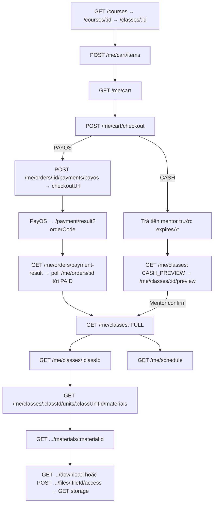

# Mindy Center — API Contract tổng hợp cho Frontend

Cập nhật: **2026-10-16**. Tài liệu này tổng hợp toàn bộ API đã có trong source BE (nhánh
`feat/phase-3-3`, đã chứa dev `e0c9174`) và các flow trong `docs/api_flow/` để FE tích hợp
từ một chỗ. Mỗi phase vẫn có flow/breakdown riêng làm nguồn chi tiết; khi hai nơi lệch
nhau, **source code + Swagger (`/docs`) là nguồn sự thật**.

| Phase | Flow | Breakdown chi tiết |
|---|---|---|
| 1 — Identity/Account | [PHASE_1_FLOW](PHASE_1_FLOW.md) | [breakdown](PHASE_1_flow-api-breakdown.md) |
| 2 — Catalog/Cart/Payment | [contract Phase 2](../PHASE_2_FE_CONTRACT.md) | (contract) |
| 2.3 — My Classes/Lịch | [PHASE_2_3_FLOW](PHASE_2_3_FLOW.md) | [breakdown](PHASE_2_3_flow-api-breakdown.md) · [contract 2.3](../PHASE_2_3_FE_CONTRACT.md) |
| 2.3 → 3.x tổng quan | [PHASE_2_3_TO_3_2_FLOW](PHASE_2_3_TO_3_2_FLOW.md) | — |
| 3.2 — Upload file | [PHASE_3_2_FLOW](PHASE_3_2_FLOW.md) | [breakdown](PHASE_3_2_flow-api-breakdown.md) |
| 3.3 — Material CRUD/review/release | [PHASE_3_3_FLOW](PHASE_3_3_FLOW.md) | [breakdown](PHASE_3_3_flow-api-breakdown.md) |
| 3.4 — Student material/preview | [PHASE_3_4_FLOW](PHASE_3_4_FLOW.md) | [breakdown](PHASE_3_4_flow-api-breakdown.md) · [FE gaps](PHASE_3_4_FE_API_GAPS.md) |
| 4 — Điểm danh/dạy thay | [PHASE_4_FLOW](PHASE_4_FLOW.md) | [breakdown](PHASE_4_flow-api-breakdown.md) |
| 4.1 / 4.2 / 4.3 | [4.1](PHASE_4_1_FLOW.md) · [4.2](PHASE_4_2_FLOW.md) · [4.3](PHASE_4_3_FLOW.md) | [4.1](PHASE_4_1_flow-api-breakdown.md) · [4.2](PHASE_4_2_flow-api-breakdown.md) · [4.3](PHASE_4_3_flow-api-breakdown.md) |

---

## Mục lục

0. [Trạng thái triển khai — đọc trước khi gọi API](#0-trạng-thái-triển-khai--đọc-trước-khi-gọi-api)
1. [Quy ước chung](#1-quy-ước-chung)
2. [Error envelope và bảng mã lỗi](#2-error-envelope-và-bảng-mã-lỗi)
3. [Enum dùng chung](#3-enum-dùng-chung)
4. [Bản đồ API theo role](#4-bản-đồ-api-theo-role)
5. [Health](#5-health)
6. [Auth và tài khoản](#6-auth-và-tài-khoản)
7. [Admin quản lý user](#7-admin-quản-lý-user)
8. [Catalog public](#8-catalog-public)
9. [Admin catalog](#9-admin-catalog)
10. [Admin quản lý lớp, buổi học, học viên](#10-admin-quản-lý-lớp-buổi-học-học-viên)
11. [Cart, checkout, order, thanh toán (Student)](#11-cart-checkout-order-thanh-toán-student)
12. [Mentor: lớp, roster, thu tiền mặt](#12-mentor-lớp-roster-thu-tiền-mặt)
13. [Admin đối soát payment](#13-admin-đối-soát-payment)
14. [Student: Lớp của tôi, chi tiết lớp, lịch](#14-student-lớp-của-tôi-chi-tiết-lớp-lịch)
15. [Files: upload private](#15-files-upload-private)
16. [Materials: soạn, duyệt, release](#16-materials-soạn-duyệt-release)
17. [Materials: Student đọc/tải và staff preview](#17-materials-student-đọctải-và-staff-preview)
18. [Teaching: quản lý mentor và dạy thay](#18-teaching-quản-lý-mentor-và-dạy-thay)
19. [Attendance: điểm danh, sửa, phục hồi, audit](#19-attendance-điểm-danh-sửa-phục-hồi-audit)
20. [Flow end-to-end theo vai trò](#20-flow-end-to-end-theo-vai-trò)
21. [Polling, cache, refetch](#21-polling-cache-refetch)
22. [API chưa có — FE không được gọi](#22-api-chưa-có--fe-không-được-gọi)
23. [Ghi chú lệch tài liệu đã phát hiện](#23-ghi-chú-lệch-tài-liệu-đã-phát-hiện)

---

## 0. Trạng thái triển khai — đọc trước khi gọi API

| Nhãn | Ý nghĩa |
|---|---|
| **IMPL** | Có trong source, đã test local (PostgreSQL test DB + HTTP E2E với provider giả). |
| **VPS ✓** | Đã có nghiệm thu trên VPS. |
| **PLANNED** | Mới có thiết kế, **chưa có route**. FE không được gọi. |

| Nhóm | Source | Môi trường |
|---|---|---|
| Auth, Users, Catalog, Classes admin, Cart/Checkout/Orders (Phase 0–2) | IMPL | Đã chạy trên server; giao dịch **PayOS thật** vẫn chờ nghiệm thu live theo runbook 2.2 |
| Phase 2.3 My Classes/Lịch, Admin sửa giờ Session, Admin roster học viên | IMPL | Chưa có bằng chứng VPS |
| Phase 3.2 Files | IMPL | **VPS ✓** (user xác nhận 2026-10-12) |
| Phase 3.3 Material CRUD/review/release, 3.4 Student materials + staff preview | IMPL (local 13–14/10) | Chưa deploy branch; chưa nghiệm thu browser |
| Phase 4.1 Teaching, 4.2 Attendance, 4.3 Correction/Recovery/Audit | IMPL (local) | Có trong dev `e0c9174` (deploy run thành công) nhưng **chưa nghiệm thu VPS/FE** |
| Phase 4.4a/b/c, 4.5 (nghỉ dạy, học bù, Student xem điểm danh…) | **PLANNED** | — |

> Một route có trong source **không** có nghĩa là môi trường FE đang gọi đã có release đó. Kiểm
> Swagger của môi trường (`/docs` khi `SWAGGER_ENABLED=true`) trước khi bật tính năng.

---

## 1. Quy ước chung

### 1.1 Base URL, version

- Mọi route BE: `{API_ORIGIN}/api/v1/...`. Trong tài liệu, route viết đầy đủ `/api/v1/...`.
- Swagger: `{API_ORIGIN}/docs` (chỉ khi bật).
- **Ngoại lệ**: PUT upload file và GET signed URL đi **trực tiếp tới storage (MinIO)**, không qua BE.

### 1.2 Xác thực bằng cookie

- Đăng nhập trả 2 cookie `HttpOnly`, `SameSite=Lax`, `Secure` theo `COOKIE_SECURE`:
  - `access_token` — path `/`, TTL mặc định **900 giây**.
  - `refresh_token` — path `/api/v1/auth/refresh`, TTL mặc định **30 ngày**, xoay vòng mỗi lần refresh.
- FE **không** đọc/lưu token. Mọi request BE gửi `credentials: 'include'` (fetch) hoặc
  `withCredentials: true` (Axios). Không dùng Bearer header, không localStorage.
- Không bao giờ gửi `studentId`, `mentorId` của chính mình, `role`, `status` để tự cấp quyền. Server
  lấy actor từ cookie.
- CORS: origin của FE phải nằm trong `CORS_ORIGINS` của BE.

### 1.3 Header `Origin` bắt buộc cho một số mutation

Các route sau kiểm tra header `Origin` phải thuộc `CORS_ORIGINS`, thiếu/sai → **403 `ORIGIN_NOT_ALLOWED`**:

- Mọi mutation `/manager/...materials...` và `/mentor/classes/:classId/...materials...` (POST/PATCH/DELETE).
- `PATCH .../units/:unitId/release` (Admin và Mentor).
- `POST /me/classes/:classId/materials/:materialId/files/:fileId/access` (Student).
- `POST .../files/:fileId/access` của Manager/Mentor.

Browser tự gửi `Origin`. Nếu FE đi qua proxy/BFF server-side thì proxy **phải chuyển tiếp nguyên header
Origin**. Khi test bằng Postman, phải tự thêm header `Origin`. GET không cần Origin.

### 1.4 Response

- Success là **DTO JSON trực tiếp**, **không** có wrapper `{ data: ... }`.
- List phân trang: `{ items, page, pageSize, total }` (một số list thêm `asOf`, `timeZone`, `from`, `to`).
- Query phân trang: `page` integer ≥1 (default 1), `pageSize` integer 1–100 (default 20 trừ khi ghi khác).
  `page` vượt quá dữ liệu → `200` với `items: []`, `total` giữ nguyên.
- Dữ liệu cá nhân trả `Cache-Control: private, no-store` (Files: `no-store`). FE không cache chéo user.
- Status code:
  - `GET` → 200; `POST` tạo resource → 201; action `POST` (approve, start, finalize, access…) → 200;
  - `PATCH`/`PUT` → 200; `DELETE` → 204 (không body); `POST /auth/register` → 202.

### 1.5 Validation

- Global ValidationPipe: whitelist + **forbidNonWhitelisted** → gửi field lạ là lỗi.
- **Path UUID sai** (ParseUUIDPipe) → **400 `HTTP_ERROR`**.
- **Body/query sai** (kiểu, enum, giới hạn, field lạ, UUID trong body/query) → **422 `HTTP_ERROR`**,
  `message`/`details` có thể là **mảng** chuỗi.
- JSON hỏng → 400 `INVALID_JSON_BODY`; body quá lớn → 413 `INVALID_JSON_BODY`. Giới hạn body mặc định
  **64 KiB**; riêng `POST .../attendance/recover` là **256 KiB**.
- UUID là **v4**.

### 1.6 Thời gian

- Response timestamps: ISO 8601 UTC (`2026-10-12T01:00:00.000Z`).
- Ngày thuần: `YYYY-MM-DD` (startDate/endDate của lớp, filter catalog).
- Timestamp gửi lên BE **phải có offset** (`Z` hoặc `+07:00`). Thiếu timezone → 422.
- Múi giờ nghiệp vụ = `APP_TIME_ZONE` (hiện `Asia/Ho_Chi_Minh`, một số ví dụ ghi `Asia/Bangkok` — cùng +07).
  Response lịch có field `timeZone`; FE dùng giá trị đó để hiển thị.
- `asOf` = thời điểm server đánh giá quyền/thời hạn. Không dùng đồng hồ client để tự quyết quyền.
- Khi build query string có `+07:00`, dùng `URLSearchParams` để encode dấu `+`.

### 1.7 Concurrency: `expectedVersion`, `expectedRevision`, `Idempotency-Key`

| Cơ chế | Dùng ở | Cách FE làm |
|---|---|---|
| `expectedRevision` (integer ≥1) | Materials (PATCH/DELETE/submit/approve/reject/publish/unpublish) | Lấy `revision` từ detail mới nhất. 409 → refetch, cho user quyết định lại. Không tự tăng rồi retry. |
| `expectedVersion` (integer ≥1) | Teaching (assignmentVersion / session version), Attendance (`session.version`), Admin PATCH class khi đổi mentor | Lấy từ GET mới nhất. 409 `SESSION_VERSION_CONFLICT`/`CLASS_ASSIGNMENT_VERSION_CONFLICT` → refetch. |
| Header `Idempotency-Key` (UUID v4) | Mọi mutation Teaching 4.1 và Attendance 4.2/4.3, Admin PATCH class có `mentorId` | Tạo **1 key cho 1 ý định**. Retry do lỗi mạng: **giữ nguyên key + body**. Đổi body/ý định → key mới. Cùng key khác body → 409 `IDEMPOTENCY_KEY_REUSED`. Thiếu/sai header → 422. |

Replay cùng key trả lại kết quả đã commit (có thể có `asOf`/`permissions` cũ) → luôn GET lại sau đó.

### 1.8 Request ID

Response có header `x-request-id`; error body có `requestId` (có thể thiếu). FE nên log/hiện mã này khi báo lỗi.

---

## 2. Error envelope và bảng mã lỗi

```json
{
  "statusCode": 409,
  "code": "MATERIAL_REVIEW_CONFLICT",
  "message": "The material action is not allowed in its current context",
  "details": ["optional"],
  "requestId": "3f0c9c1e-0000-4000-8000-000000000000"
}
```

- `details`, `requestId` có thể không có. `message` có thể là string **hoặc mảng** (validation).
- FE xử lý theo **`statusCode` + `code`**, không so sánh `message`.

### 2.1 Mã lỗi chung

| Status | Code | Khi nào | FE xử lý |
|---|---|---|---|
| 400 | `HTTP_ERROR` | Path UUID sai | Sửa route/ID; không retry |
| 400 | `INVALID_JSON_BODY` | JSON hỏng | Sửa request |
| 401 | `AUTHENTICATION_REQUIRED` | Thiếu/hết hạn `access_token`, session bị thu hồi, user không còn ACTIVE | Gọi `POST /auth/refresh` **một lần**; thất bại → về login, xoá cache user |
| 401 | `INVALID_REFRESH_TOKEN` | Refresh token sai/hết hạn/bị dùng lại | Về login (cookie đã bị xoá) |
| 403 | `INSUFFICIENT_ROLE` | Sai role cho route | Ẩn tính năng; không retry |
| 403 | `ORIGIN_NOT_ALLOWED` | Thiếu/sai Origin ở route yêu cầu | Lỗi cấu hình FE/proxy; không retry |
| 409 | `UNIQUE_CONSTRAINT_VIOLATION` | Vi phạm unique DB chưa map | Refetch |
| 413 | `INVALID_JSON_BODY` | Body vượt giới hạn | Giảm payload |
| 422 | `HTTP_ERROR` | Validation body/query | Hiện lỗi field |
| 422 | `FOREIGN_KEY_VIOLATION` / `CHECK_CONSTRAINT_VIOLATION` | Dữ liệu vi phạm rule DB chưa map | Hiện lỗi chung |
| 500 | `INTERNAL_SERVER_ERROR` | Lỗi ngoài dự kiến | Retry có giới hạn, hiện requestId |

### 2.2 Mã lỗi nghiệp vụ theo domain

| Domain | Status → Code |
|---|---|
| Auth | 401 `INVALID_CREDENTIALS`, 401 `INVALID_REGISTRATION_INTENT`, 401 `GOOGLE_AUTHENTICATION_FAILED`, 400 `INVALID_EMAIL_VERIFICATION_TOKEN`, 503 `MAIL_DELIVERY_UNAVAILABLE` |
| Users | 404 `USER_NOT_FOUND`, 409 `USER_EMAIL_ALREADY_EXISTS`, 409 `USER_PHONE_ALREADY_EXISTS` |
| Catalog | 404 `COURSE_NOT_FOUND`, 404 `COURSE_CATEGORY_NOT_FOUND`, 409 `COURSE_CODE_ALREADY_EXISTS`, 409 `COURSE_CATEGORY_SLUG_ALREADY_EXISTS`, 409 `COURSE_CATEGORY_INACTIVE`, 409 `COURSE_HAS_NO_UNITS`, 409 `COURSE_UNIT_ORDER_MISMATCH`, 422 `COURSE_CATEGORY_SLUG_REQUIRED` |
| Classes | 404 `CLASS_NOT_FOUND`, 404 `CLASS_UNIT_NOT_FOUND`, 404 `CLASS_SESSION_NOT_FOUND`, 404 `CLASS_STUDENT_NOT_FOUND`, 409 `CLASS_CODE_ALREADY_EXISTS`, 409 `CLASS_COURSE_INACTIVE`, 409 `CLASS_NOT_OPEN`, 409 `CLASS_FULL`, 409 `CLASS_ALREADY_ENROLLED`, 409 `CLASS_NOT_EDITABLE`, 409 `CLASS_INVALID_TRANSITION`, 409 `CLASS_NOT_READY_TO_OPEN`, 409 `CLASS_SESSION_NOT_EDITABLE`, 409 `CLASS_SESSION_OVERLAP`, 409 `CLASS_MENTOR_SCHEDULE_CONFLICT`, 409 `UNIT_RELEASE_CONFLICT`, 422 `CLASS_DATE_RANGE_INVALID`, 422 `CLASS_SESSION_TIME_RANGE_INVALID`, 422 `CLASS_SESSION_OUTSIDE_CLASS_PERIOD`, 422 `CLASS_SESSION_LOCAL_TIME_INVALID`, 422 `CLASS_SESSION_OVERNIGHT_NOT_ALLOWED`, 422 `CLASS_MENTOR_NOT_ELIGIBLE` |
| Student access | 403 `CLASS_ACCESS_DENIED`, 403 `CLASS_PREVIEW_DENIED`, 403 `SCHEDULE_CLASS_ACCESS_DENIED` |
| Cart/Order | 404 `CART_ITEM_NOT_FOUND`, 409 `CART_ITEM_ALREADY_EXISTS`, 409 `CART_LIMIT_EXCEEDED` (tối đa 20 lớp), 409 `CART_EMPTY`, 404 `ORDER_NOT_FOUND`, 403 `ORDER_ACCESS_DENIED` |
| Payment | 409 `PAYMENT_ORDER_INVALID`, 422 `PAYMENT_AMOUNT_INVALID`, 503 `PAYMENT_UNAVAILABLE`, 400 `INVALID_PAYMENT_WEBHOOK` (provider) |
| Cash | 409 `CASH_CONFIRMATION_INVALID`, 409 `CASH_ORDER_CLOSED`, 409 `CASH_HOLD_INVALID`, 403 `ORDER_ACCESS_DENIED` |
| Files | 404 `FILE_NOT_FOUND`, 409 `FILE_NOT_READY`, 409 `UPLOAD_EXPIRED`, 409 `UPLOAD_FAILED`, 409 `FILE_DELETED`, 403 `FILE_OWNER_MISMATCH`, 429 `FILE_UPLOAD_QUOTA_EXCEEDED`, 503 `FILE_STORAGE_DISABLED`, 503 `FILE_STORAGE_UNAVAILABLE` |
| Materials | 403 `MATERIAL_ACCESS_DENIED`, 404 `MATERIAL_NOT_FOUND`, 409 `MATERIAL_REVIEW_CONFLICT`, 413 `MATERIAL_CONTENT_TOO_LARGE`, 422 `MATERIAL_CONTENT_INVALID`, 422 `MATERIAL_SCOPE_MISMATCH` |
| Teaching/Attendance | 403 `SESSION_ASSIGNMENT_REQUIRED`, 409 `SESSION_VERSION_CONFLICT`, 409 `CLASS_ASSIGNMENT_VERSION_CONFLICT`, 409 `SESSION_STATE_CONFLICT`, 409 `IDEMPOTENCY_KEY_REUSED`, 409 `ATTENDANCE_START_DAY_CLOSED`, 409 `ATTENDANCE_EDIT_WINDOW_EXPIRED`, 409 `ATTENDANCE_RECOVERY_RECORD_EXISTS`, 409 `ATTENDANCE_RECOVERY_CLOCK_CONFLICT`, 422 `ATTENDANCE_ENROLLMENT_NOT_ELIGIBLE`, 422 `ATTENDANCE_RECOVERY_EVIDENCE_INVALID` |

`FileStatusDto.errorCode` (không phải HTTP code): `FILE_BINARY_INVALID`, `FILE_SIZE_MISMATCH`,
`FILE_RETRY_EXHAUSTED`, `UPLOAD_EXPIRED`.

---

## 3. Enum dùng chung

| Enum | Giá trị |
|---|---|
| UserRole | `ADMIN`, `MANAGER`, `MENTOR`, `STUDENT` |
| UserStatus | `PENDING_VERIFICATION`, `ACTIVE`, `SUSPENDED` |
| DeliveryMode | `ONLINE`, `OFFLINE` |
| ClassStatus | `DRAFT`, `OPEN`, `IN_PROGRESS`, `COMPLETED`, `CANCELLED` |
| ClassUnitStatus | `LOCKED`, `OPEN`, `COMPLETED` |
| SessionStatus | `SCHEDULED`, `IN_PROGRESS`, `COMPLETED`, `CANCELLED` |
| PaymentType | `PAYOS`, `CASH` |
| OrderStatus | `PENDING`, `PAID`, `EXPIRED`, `CANCELLED` |
| PaymentStatus | `CREATING`, `PENDING`, `SUCCEEDED`, `REQUIRES_REVIEW` |
| EnrollmentStatus | `PENDING_PAYMENT`, `ACTIVE`, `COMPLETED`, `CANCELLED` |
| AccessMode (My Classes) | `FULL`, `CASH_PREVIEW`, `NONE` |
| AccessReason | `ACTIVE_ENROLLMENT`, `PENDING_CASH`, `PENDING_PAYOS`, `HOLD_EXPIRED`, `ENROLLMENT_CANCELLED`, `ENROLLMENT_COMPLETED`, `CLASS_CANCELLED`, `STATE_MISMATCH` |
| FileStatus | `PENDING_UPLOAD`, `PROCESSING`, `READY`, `FAILED`, `DELETED` |
| FileKind | `PDF`, `IMAGE`, `DOCUMENT`, `PRESENTATION`, `SPREADSHEET`, `AUDIO`, `VIDEO`, `SOURCE_CODE` |
| MaterialContentType | `ARTICLE`, `FILE`, `VIDEO` |
| MaterialReviewStatus | `DRAFT`, `PENDING_REVIEW`, `APPROVED`, `REJECTED` |
| MaterialFileRole | `PRIMARY`, `INLINE_IMAGE`, `ATTACHMENT` |
| AssignmentType | `PRIMARY`, `SUBSTITUTE` |
| AttendanceStatus | `UNMARKED`, `PRESENT`, `ABSENT` |
| AttendanceAuditAction | `ADMIT`, `MARK`, `FINALIZE`, `CORRECT`, `RECOVER` |
| AdmissionBasis (recover) | `PAID_BEFORE_START`, `CASH_LATE_ADMISSION` |

---

## 4. Bản đồ API theo role

Tất cả route có prefix `/api/v1`. "Origin" = cần header Origin (§1.3). "Idem" = cần `Idempotency-Key`.

### Public (không cần đăng nhập)

| Method | Route | Mục đích |
|---|---|---|
| GET | `/health/live`, `/health/ready` | Health check |
| POST | `/auth/register` | Đăng ký Student |
| POST | `/auth/email/resend` | Gửi lại mail xác thực |
| POST | `/auth/email/verify` | Xác thực email + đăng nhập |
| POST | `/auth/login` | Đăng nhập email/password |
| POST | `/auth/refresh` | Xoay refresh token |
| GET | `/auth/google` → `/auth/google/callback` | Google OIDC (redirect) |
| GET | `/auth/registration-context` | Prefill đăng ký Google (cookie intent) |
| POST | `/auth/google/complete-registration` | Hoàn tất đăng ký Google |
| GET | `/course-categories` | Danh mục khoá học |
| GET | `/courses`, `/courses/:courseId`, `/courses/:courseId/classes` | Khoá học active, lớp OPEN |
| GET | `/classes/:classId` | Lớp OPEN + timetable |

### Mọi user đã đăng nhập

| Method | Route |
|---|---|
| GET | `/auth/me` |
| POST | `/auth/logout`, `/auth/logout-all` |

### STUDENT

| Method | Route | Mục đích |
|---|---|---|
| GET | `/me/cart` | Giỏ hàng |
| POST | `/me/cart/items` | Thêm lớp |
| DELETE | `/me/cart/items/:classId` | Bỏ lớp |
| POST | `/me/cart/checkout` | Tạo order + giữ chỗ |
| GET | `/me/orders` | Lịch sử order |
| GET | `/me/orders/:orderId` | Order + payment |
| GET | `/me/orders/payment-result?orderCode=` | Tra order sau redirect PayOS |
| POST | `/me/orders/:orderId/payments/payos` | Tạo/tái dùng link PayOS |
| GET | `/me/classes` | Lớp của tôi + access hint |
| GET | `/me/classes/:classId` | Chi tiết lớp đầy đủ (ACTIVE) |
| GET | `/me/classes/:classId/preview` | Preview lớp (CASH pending) |
| GET | `/me/schedule` | Lịch cá nhân |
| GET | `/me/classes/:classId/units/:classUnitId/materials` | Tài liệu của chương |
| GET | `/me/classes/:classId/materials/:materialId` | Chi tiết tài liệu |
| GET | `/me/classes/:classId/materials/:materialId/download` | Signed URL primary FILE/VIDEO |
| POST | `/me/classes/:classId/materials/:materialId/files/:fileId/access` | Signed URL từng file (Origin) |

### MENTOR

| Method | Route | Mục đích |
|---|---|---|
| GET | `/mentor/classes` | Lớp được phân công (primary) |
| GET | `/mentor/classes/:classId/students` | Học viên + thông tin thu tiền |
| GET | `/mentor/cash-orders` | Order CASH mình phụ trách |
| POST | `/mentor/cash-orders/:orderId/confirm` | Xác nhận đã thu tiền |
| GET | `/mentor/classes/:classId/units` | Context Class Unit ↔ Course Unit |
| GET | `/mentor/classes/:classId/units/:unitId/sessions` | Context buổi học |
| PATCH | `/mentor/classes/:classId/units/:unitId/release` | Mở/khoá chương (Origin) |
| GET/POST | `/mentor/classes/:classId/units/:unitId/materials` | List/tạo tài liệu (POST: Origin) |
| GET/PATCH/DELETE | `/mentor/classes/:classId/materials/:materialId` | Detail/sửa/xoá (Origin cho ghi) |
| POST | `/mentor/classes/:classId/materials/:materialId/submit` | Gửi duyệt (Origin) |
| POST | `/mentor/classes/:classId/materials/:materialId/files/:fileId/access` | Preview file (Origin) |
| POST/GET | `/files/upload-intents`, `/files/:fileId/complete`, `/files/:fileId` | Upload |
| GET | `/mentor/schedule` | Lịch dạy (gồm dạy thay) |
| GET | `/class-sessions/:sessionId/context` | Phòng/meeting của buổi |
| GET/PUT | `/class-sessions/:sessionId/attendance` | Roster / điểm danh (PUT: Idem) |
| POST | `/class-sessions/:sessionId/start`, `/attendance/sync-roster`, `/finalize` | Vòng đời buổi (Idem) |

### MANAGER

| Method | Route | Mục đích |
|---|---|---|
| POST/GET | `/files/...` | Upload |
| GET/POST | `/manager/course-units/:courseUnitId/materials` | List/tạo tài liệu (POST: Origin) |
| GET | `/manager/materials` | Hàng đợi/danh sách |
| GET/PATCH/DELETE | `/manager/materials/:materialId` | Detail/sửa/xoá (Origin cho ghi) |
| POST | `/manager/materials/:materialId/approve`, `/reject`, `/publish`, `/unpublish` | Duyệt/xuất bản (Origin) |
| POST | `/manager/materials/:materialId/files/:fileId/access` | Preview file (Origin) |
| GET/PATCH | `/management/...` (§18) | Teaching (dùng chung với ADMIN) |
| GET/POST/PUT | `/class-sessions/...`, `/management/class-sessions/...` (§19) | Attendance staff |

### ADMIN

| Method | Route | Mục đích |
|---|---|---|
| POST/GET/PATCH | `/admin/users`, `/admin/users/:userId`, `/admin/users/:userId/status` | Quản lý tài khoản |
| POST | `/admin/course-categories` | Tạo danh mục |
| GET/POST/PATCH/PUT | `/admin/courses...` | Quản lý khoá học |
| GET/POST/PATCH | `/admin/classes...` | Quản lý lớp, buổi, lifecycle |
| GET | `/admin/classes/:classId/students[/:studentId]` | Roster học viên |
| PATCH | `/admin/classes/:classId/units/:unitId/release` | Mở/khoá chương (Origin) |
| GET/POST | `/admin/payments/reconciliation`, `/admin/payments/:paymentId/reconcile` | Đối soát |
| (như MANAGER) | `/management/...`, `/class-sessions/...` | Teaching/attendance |

> ADMIN **không** có quyền Files/Materials authoring. MANAGER **không** có quyền `/admin/*` và
> không release chương.

---

## 5. Health

| Route | Response 200 |
|---|---|
| `GET /api/v1/health/live` | `{ "status": "ok", "timestamp": "..." }` |
| `GET /api/v1/health/ready` | Như trên; **503** nếu dependency bắt buộc (DB) chưa sẵn sàng |

---

## 6. Auth và tài khoản

Response đăng nhập dùng chung `AuthenticatedUserDto`:

```json
{
  "user": {
    "id": "11111111-1111-4111-8111-111111111111",
    "email": "student@example.test",
    "phone": null,
    "displayName": "Nguyễn An",
    "role": "STUDENT",
    "status": "ACTIVE",
    "lastLoginAt": "2026-10-16T02:00:00.000Z",
    "createdAt": "2026-10-01T03:00:00.000Z"
  },
  "accessTokenExpiresAt": "2026-10-16T02:15:00.000Z"
}
```

`UserDto` = object `user` ở trên. Không bao giờ có password/hash/token. `phone`, `lastLoginAt` nullable.

### 6.1 POST `/api/v1/auth/register` — Public — 202

| Field | Rule |
|---|---|
| `email` | email, ≤320 (server trim/lowercase) |
| `password` | string **6–128** (không trim) |
| `displayName` | string 1–150, phải có ký tự khác khoảng trắng |
| `phone` | optional, 7–32 — bỏ field nếu rỗng |

Không gửi `role`/`status` (422). Luôn tạo **STUDENT**, trạng thái `PENDING_VERIFICATION`.

Response `202 { "message": "If the address can be registered, a verification email has been sent." }`.
Response giống nhau dù email đã tồn tại → FE luôn hiện "Kiểm tra email". Không có cookie/session.
503 `MAIL_DELIVERY_UNAVAILABLE` khi mail tạm ngừng.

### 6.2 POST `/api/v1/auth/email/resend` — Public — 202

Body `{ "email": "student@example.test" }`. Response như register. Không tiết lộ email có tồn tại.

### 6.3 POST `/api/v1/auth/email/verify` — Public — 200

FE nhận `token` từ link email (trang `EMAIL_VERIFICATION_PATH` của FE), gọi:

```json
{ "token": "<32–512 ký tự từ link>", "deviceName": "Chrome on Windows" }
```

`deviceName` optional ≤150. 200 `AuthenticatedUserDto` **và set cookie** (đã đăng nhập).
Token dùng một lần, TTL mặc định 30 phút. Sai/hết hạn → 400 `INVALID_EMAIL_VERIFICATION_TOKEN`
→ cho phép "Gửi lại email".

### 6.4 POST `/api/v1/auth/login` — Public — 200

```json
{ "email": "admin@example.test", "password": "123456", "deviceName": "Chrome on Windows" }
```

`password` 1–128, `deviceName` optional ≤150. 200 `AuthenticatedUserDto` + cookie.
401 `INVALID_CREDENTIALS` là lỗi chung (không phân biệt sai email hay sai mật khẩu).
Điều hướng sau login theo `user.role`.

### 6.5 POST `/api/v1/auth/refresh` — cookie `refresh_token` — 200

Không body. 200 `AuthenticatedUserDto` + cookie mới. Lỗi → 401 `INVALID_REFRESH_TOKEN`, server xoá cookie.

**Khuyến nghị FE**: interceptor bắt 401 `AUTHENTICATION_REQUIRED` → gọi refresh **một lần**
(single-flight, các request song song chờ chung) → retry request gốc một lần → nếu vẫn lỗi thì về login.
Có thể chủ động refresh trước `accessTokenExpiresAt`.

### 6.6 POST `/api/v1/auth/logout` và `/auth/logout-all` — 204

Cần `access_token`. `logout` thu hồi session hiện tại; `logout-all` thu hồi mọi session. Server xoá cookie.
FE xoá toàn bộ cache dữ liệu user, huỷ polling, xoá signed URL trong bộ nhớ.

### 6.7 GET `/api/v1/auth/me` — 200 `UserDto`

Dùng khi bootstrap app. 401 nếu chưa đăng nhập hoặc tài khoản không còn ACTIVE.

### 6.8 Google OIDC

1. FE điều hướng trình duyệt (không fetch) tới
   `GET /api/v1/auth/google?returnTo=/dashboard` (`returnTo` optional, phải là path nội bộ bắt đầu bằng `/`, ≤500).
2. BE redirect sang Google → callback `GET /api/v1/auth/google/callback` (BE xử lý).
3. Kết quả là redirect 302 về FE:
   - Tài khoản đã có → set cookie, về `{FRONTEND_BASE_URL}{returnTo}`.
   - Tài khoản mới → set cookie tạm `registration_intent`, về `GOOGLE_REGISTRATION_PATH` của FE.
   - Lỗi → về `GOOGLE_AUTH_ERROR_PATH?error=google_authentication_failed`.
4. Ở trang đăng ký Google, FE gọi `GET /api/v1/auth/registration-context` →
   `{ email, displayName|null, avatarUrl|null, expiresAt }`. `email` read-only; displayName/avatar chỉ là gợi ý.
5. FE submit `POST /api/v1/auth/google/complete-registration` (201):
   `{ "displayName": "Nguyễn An", "phone": "0901234567", "deviceName": "Chrome" }`
   (`displayName` 1–150 bắt buộc, `phone` 7–32 optional, `deviceName` optional) → `AuthenticatedUserDto` + cookie.
6. Intent hết hạn (mặc định 15 phút)/sai → 401 `INVALID_REGISTRATION_INTENT` → bắt đầu lại từ bước 1.

---

## 7. Admin quản lý user

Role **ADMIN**. Không có self-service profile/đổi mật khẩu/quên mật khẩu (xem §22).

### POST `/api/v1/admin/users` — 201 `UserDto`

| Field | Rule |
|---|---|
| `email` | email ≤320 |
| `password` | **6–128** (cho mọi role) |
| `displayName` | 1–150 |
| `role` | `ADMIN`/`MANAGER`/`MENTOR`/`STUDENT` |
| `phone` | optional 7–32 |

Tài khoản tạo ra **ACTIVE ngay**, không cần verify email, không tự đăng nhập. Đây là cách duy nhất
để tạo MANAGER/MENTOR. Không có idempotency key → nếu mất response, refetch list trước khi tạo lại.
409 `USER_EMAIL_ALREADY_EXISTS` / `USER_PHONE_ALREADY_EXISTS` → hiện lỗi field.

### GET `/api/v1/admin/users?page=1&pageSize=20&role=MENTOR&status=ACTIVE`

200 `{ items: UserDto[], page, pageSize, total }`, sort `createdAt DESC`. `role`, `status` optional.

### GET `/api/v1/admin/users/:userId` — 200 `UserDto`; 404 `USER_NOT_FOUND`.

### PATCH `/api/v1/admin/users/:userId/status` — 200 `UserDto`

Body `{ "status": "SUSPENDED" }` hoặc `"ACTIVE"`. Tài khoản bị khoá sẽ nhận 401 ở request kế tiếp.

> FE phải hỗ trợ role `MANAGER` trong schema/enum; nếu schema chỉ có ADMIN/MENTOR/STUDENT thì
> list user có Manager sẽ lỗi parse (gap P0 trong [FE gaps](PHASE_3_4_FE_API_GAPS.md)).

---

## 8. Catalog public

Không cần cookie, không trả meeting URL.

### GET `/api/v1/course-categories?page=1&pageSize=20`

200 `{ items: [{ id, name, slug, description|null, isActive }], page, pageSize, total }`.

### GET `/api/v1/courses`

Query: `page`, `pageSize`, `categoryId` (UUID), `deliveryMode` (`ONLINE`/`OFFLINE`),
`startsFrom`, `startsTo` (`YYYY-MM-DD`). Khi có `deliveryMode`/`startsFrom`/`startsTo`, chỉ trả các
khoá học **có lớp OPEN khớp filter**.

200 `{ items: CourseDto[], page, pageSize, total }`:

```json
{
  "id": "22222222-2222-4222-8222-222222222222",
  "code": "WEB101",
  "title": "Web cơ bản",
  "description": null,
  "imgUrl": null,
  "priceAmount": 1500000,
  "category": { "id": "…", "name": "Lập trình", "slug": "lap-trinh" }
}
```

`priceAmount` là số nguyên VND.

### GET `/api/v1/courses/:courseId` — 200 `PublicCourseDetailDto`

`CourseDto` + `units[]` + `openClasses[]`:

- `units[]`: `{ id (courseUnitId), unitNumber, title, description|null, requiredScorePercent }`.
- `openClasses[]`: các lớp OPEN sớm nhất (`ClassDto`); xem thêm qua endpoint dưới.
- 404 `COURSE_NOT_FOUND` nếu khoá học không tồn tại/không active.

### GET `/api/v1/courses/:courseId/classes`

Query: `page`, `pageSize`, `deliveryMode`, `startsFrom`, `startsTo`. 200 `{ items: ClassDto[], … }`:

```json
{
  "id": "33333333-3333-4333-8333-333333333333",
  "courseId": "22222222-2222-4222-8222-222222222222",
  "code": "WEB101-A",
  "name": "Web lớp A",
  "startDate": "2026-10-13",
  "endDate": "2026-11-14",
  "deliveryMode": "ONLINE",
  "maxStudents": 20,
  "availableSeats": 5,
  "mentor": { "id": "44444444-4444-4444-8444-444444444444", "displayName": "Mentor Demo" }
}
```

### GET `/api/v1/classes/:classId` — 200 `ClassDetailDto`

`ClassDto` + `units[]`: `{ id (classUnitId), position, title, sessions[] }`;
session `{ id, sessionNumber, title, startsAt, endsAt, roomName|null, status }`.
Chỉ lớp OPEN. Lớp không OPEN/không tồn tại → 404 `CLASS_NOT_FOUND`.

> `courseUnitId` (Course Unit, thuộc khoá học) ≠ `classUnitId` (Class Unit, thuộc từng lớp). Không
> ghép theo title/position.

---

## 9. Admin catalog

Role **ADMIN**.

| Method + route | Body | Response |
|---|---|---|
| POST `/api/v1/admin/course-categories` | `{ name (1–150), slug? (kebab-case 1–180), description? (≤2000) }` | 201 `CourseCategoryDto` |
| GET `/api/v1/admin/courses?page&pageSize&categoryId&isActive` | — | 200 `{ items: CourseManagementDto[], … }` (CourseDto + `isActive`, `createdAt`, `updatedAt`) |
| GET `/api/v1/admin/courses/:courseId` | — | 200 `CourseManagementDetailDto` (+ `units[]`) |
| POST `/api/v1/admin/courses` | `{ categoryId, code (2–50, `[A-Za-z0-9][A-Za-z0-9_-]*`), title (1–250), description? (≤10000), imgUrl? (http/https ≤2048 hoặc null), priceAmount (int 0–1e12) }` | 201 `CourseManagementDetailDto` |
| PATCH `/api/v1/admin/courses/:courseId` | Bất kỳ: `categoryId`, `title`, `description` (null xoá), `imgUrl` (null xoá), `priceAmount` | 200 `CourseManagementDetailDto` |
| POST `/api/v1/admin/courses/:courseId/units` | `{ title (1–250), description? (≤10000), requiredScorePercent? (0–100, 2 chữ số thập phân) }` | 201 `CourseUnitDto` |
| PUT `/api/v1/admin/courses/:courseId/units/order` | `{ unitIds: UUID[] }` — đủ toàn bộ unit, không trùng, 1–200 | 200 `CourseManagementDetailDto` |
| POST `/api/v1/admin/courses/:courseId/activate` | — | 200 `CourseManagementDetailDto` |

Lỗi chính: 409 `COURSE_CODE_ALREADY_EXISTS`, `COURSE_CATEGORY_SLUG_ALREADY_EXISTS`,
`COURSE_CATEGORY_INACTIVE`, `COURSE_HAS_NO_UNITS` (activate khi chưa có unit),
`COURSE_UNIT_ORDER_MISMATCH` (danh sách unitIds không khớp); 404 `COURSE_NOT_FOUND`/`COURSE_CATEGORY_NOT_FOUND`.

> Chưa có picker catalog cho MANAGER (kể cả khoá học inactive). Manager hiện lấy `courseUnitId` từ
> `GET /courses/:courseId` (chỉ khoá active).

---

## 10. Admin quản lý lớp, buổi học, học viên

Role **ADMIN**. Response chung `ClassManagementDetailDto`:

```json
{
  "id": "33333333-3333-4333-8333-333333333333",
  "courseId": "22222222-2222-4222-8222-222222222222",
  "code": "WEB101-A", "name": "Web lớp A",
  "startDate": "2026-10-13", "endDate": "2026-11-14",
  "deliveryMode": "ONLINE", "maxStudents": 20, "availableSeats": 5,
  "mentor": { "id": "44444444-4444-4444-8444-444444444444", "displayName": "Mentor Demo" },
  "assignmentVersion": 2,
  "status": "OPEN",
  "meetingUrl": "https://meet.example.test/web101-a",
  "createdAt": "2026-10-01T03:00:00.000Z",
  "updatedAt": "2026-10-10T03:00:00.000Z",
  "units": [{
    "id": "55555555-5555-4555-8555-555555555555",
    "courseUnitId": "66666666-6666-4666-8666-666666666666",
    "position": 1, "title": "Unit 1",
    "status": "LOCKED", "unlockAt": null,
    "sessions": [{
      "id": "77777777-7777-4777-8777-777777777777",
      "classUnitId": "55555555-5555-4555-8555-555555555555",
      "sessionNumber": 1, "title": "Buổi 1",
      "startsAt": "2026-10-13T08:00:00.000Z", "endsAt": "2026-10-13T10:00:00.000Z",
      "roomName": null, "status": "SCHEDULED", "meetingUrl": null
    }]
  }]
}
```

### 10.1 Lớp

| Method + route | Body/query | Response |
|---|---|---|
| GET `/api/v1/admin/classes` | `page, pageSize, courseId?, mentorId?, status?, deliveryMode?` | 200 `{ items: ClassManagementDto[], … }` |
| GET `/api/v1/admin/classes/:classId` | — | 200 `ClassManagementDetailDto` |
| POST `/api/v1/admin/classes` | `{ courseId, mentorId, code (2–50), name (1–250), startDate, endDate (YYYY-MM-DD), maxStudents (1–1000), deliveryMode, meetingUrl? (≤2048) }` | 201 detail; lớp ở `DRAFT`, units sinh từ Course Units |
| PATCH `/api/v1/admin/classes/:classId` | Bất kỳ: `name`, `startDate`, `endDate`, `maxStudents`, `deliveryMode`, `meetingUrl` (null xoá). **Đổi mentor**: `mentorId` + `expectedVersion` (= `assignmentVersion`) + `reason` (1–1000) + header `Idempotency-Key`; gửi các field mentor **riêng** với các field khác | 200 detail |
| POST `/api/v1/admin/classes/:classId/sessions` | `{ classUnitId, title (1–250), startsAt, endsAt (ISO có offset), roomName? (≤150), meetingUrl? }` | 201 detail |
| POST `/api/v1/admin/classes/:classId/open` | — | 200 detail (`DRAFT → OPEN`) |
| POST `/api/v1/admin/classes/:classId/start` | — | 200 detail (`→ IN_PROGRESS`) |
| POST `/api/v1/admin/classes/:classId/complete` | — | 200 detail (`→ COMPLETED`; bị chặn nếu còn Session SCHEDULED/IN_PROGRESS → 409 `SESSION_STATE_CONFLICT`) |
| POST `/api/v1/admin/classes/:classId/cancel` | — | 200 detail (`→ CANCELLED`) |

Lỗi: 409 `CLASS_CODE_ALREADY_EXISTS`, `CLASS_COURSE_INACTIVE`, `CLASS_NOT_EDITABLE`,
`CLASS_INVALID_TRANSITION`, `CLASS_NOT_READY_TO_OPEN`, `CLASS_SESSION_OVERLAP`,
`CLASS_MENTOR_SCHEDULE_CONFLICT`; 422 `CLASS_DATE_RANGE_INVALID`,
`CLASS_SESSION_TIME_RANGE_INVALID`, `CLASS_SESSION_OUTSIDE_CLASS_PERIOD`,
`CLASS_SESSION_OVERNIGHT_NOT_ALLOWED` (buổi học không được qua đêm), `CLASS_MENTOR_NOT_ELIGIBLE`.

### 10.2 Sửa giờ buổi học (giữ nguyên ngày)

| Route | Body |
|---|---|
| PATCH `/api/v1/admin/classes/:classId/sessions/:sessionId` | `{ "startTime": "07:30", "endTime": "09:30" }` |
| PATCH `/api/v1/admin/classes/:classId/sessions/bulk` | `{ "sessionIds": [UUID…], "startTime": "07:30", "endTime": "09:30" }` |

- `HH:mm` đúng định dạng 00:00–23:59 (không `7:30`, `24:00`, giây). `sessionIds` 1–100 UUID không trùng,
  phải thuộc lớp. Hơn 100 buổi → chia nhiều request (mỗi request atomic riêng).
- Server ghép giờ với **ngày hiện tại của buổi** theo `APP_TIME_ZONE`. Chỉ Class `DRAFT/OPEN/IN_PROGRESS`
  và Session `SCHEDULED`. Bulk lỗi 1 buổi → rollback toàn bộ.
- 200 `ClassManagementDetailDto`. Lỗi: 404 `CLASS_NOT_FOUND`/`CLASS_SESSION_NOT_FOUND`, 409
  `CLASS_NOT_EDITABLE`/`CLASS_SESSION_NOT_EDITABLE`/`CLASS_SESSION_OVERLAP`/`CLASS_MENTOR_SCHEDULE_CONFLICT`,
  422 `CLASS_SESSION_TIME_RANGE_INVALID`/`CLASS_SESSION_OUTSIDE_CLASS_PERIOD`/`CLASS_SESSION_LOCAL_TIME_INVALID`.
- Sau thành công: dùng detail mới, invalidate lịch Student.

### 10.3 Roster học viên theo lớp

**GET `/api/v1/admin/classes/:classId/students?page=1&pageSize=20`** — 200:

```json
{
  "items": [{
    "studentId": "22222222-2222-4222-8222-222222222222",
    "studentName": "Nguyễn An",
    "email": "an@example.test",
    "phone": null,
    "studentStatus": "ACTIVE",
    "enrollmentId": "33333333-3333-4333-8333-333333333333",
    "enrollmentStatus": "PENDING_PAYMENT",
    "enrolledAt": null
  }],
  "page": 1, "pageSize": 20, "total": 1
}
```

Chỉ enrollment `PENDING_PAYMENT/ACTIVE/COMPLETED` (không có CANCELLED). Sort đăng ký mới nhất trước.
`PENDING_PAYMENT` **không** có nghĩa đã trả tiền.

**GET `/api/v1/admin/classes/:classId/students/:studentId`** — 200: các field trên + `classId`,
`orderDetailId` (không phải orderId), `registeredAt`, `accountCreatedAt`, `lastLoginAt|null`.
404 `CLASS_STUDENT_NOT_FOUND` nếu học viên không thuộc lớp.

### 10.4 Mở/khoá chương — xem §16.6.

---

## 11. Cart, checkout, order, thanh toán (Student)

Role **STUDENT**. Quy tắc nghiệp vụ:

- **Chỉ thanh toán toàn bộ** (không trả góp). **Giá luôn do server tính**; FE không gửi giá.
- Checkout giữ chỗ (seat hold) đến `expiresAt`: PayOS mặc định **15 phút**, CASH mặc định **48 giờ**.
- **Redirect PayOS không xác nhận thanh toán.** Chỉ khi BE báo `PAID` mới có quyền học.

### 11.1 GET `/api/v1/me/cart` — 200 `CartDto`

```json
{
  "items": [{
    "classId": "33333333-3333-4333-8333-333333333333",
    "classCode": "WEB101-A", "className": "Web lớp A",
    "courseId": "22222222-2222-4222-8222-222222222222", "courseTitle": "Web cơ bản",
    "deliveryMode": "ONLINE", "startDate": "2026-10-13", "endDate": "2026-11-14",
    "priceSnapshot": 1500000,
    "currentPriceAmount": 1500000,
    "isPurchasable": true,
    "addedAt": "2026-10-10T03:00:00.000Z"
  }],
  "totalAmount": 1500000
}
```

`currentPriceAmount` là giá sẽ tính khi checkout (có thể khác `priceSnapshot`, cần hiện thay đổi).
`isPurchasable=false` → lớp không còn mua được, hiện cảnh báo và gợi ý bỏ khỏi giỏ. `totalAmount` chỉ để hiển thị.

### 11.2 POST `/api/v1/me/cart/items` — 201 `CartDto`

Body `{ "classId": "<UUID v4 lớp OPEN>" }`. Lỗi: 404 `CLASS_NOT_FOUND`, 409 `CART_ITEM_ALREADY_EXISTS`,
`CART_LIMIT_EXCEEDED` (tối đa 20), `CLASS_NOT_OPEN`, `CLASS_FULL`, `CLASS_ALREADY_ENROLLED`.

### 11.3 DELETE `/api/v1/me/cart/items/:classId` — 204

404 `CART_ITEM_NOT_FOUND`.

### 11.4 POST `/api/v1/me/cart/checkout` — 201 `CheckoutResultDto`

Body `{ "paymentType": "PAYOS" }` hoặc `"CASH"`. Checkout **toàn bộ giỏ**.

- `PAYOS`: **1 order** cho cả giỏ.
- `CASH`: **1 order cho mỗi mentor** (mentor sẽ thu tiền). Tất cả order tạo trong một transaction.

```json
{
  "orders": [{
    "id": "55555555-5555-4555-8555-555555555555",
    "orderCode": "MD7K3QX9PA2B4C",
    "paymentType": "CASH",
    "status": "PENDING",
    "totalAmount": 1500000,
    "expiresAt": "2026-10-12T10:00:00.000Z",
    "paidAt": null,
    "mentorId": "44444444-4444-4444-8444-444444444444",
    "createdAt": "2026-10-10T10:00:00.000Z",
    "details": [{
      "id": "66666666-6666-4666-8666-666666666666",
      "classId": "33333333-3333-4333-8333-333333333333",
      "courseTitle": "Web cơ bản", "className": "Web lớp A",
      "priceAmount": 1500000, "quantity": 1, "totalAmount": 1500000
    }]
  }]
}
```

Lỗi: 409 `CART_EMPTY`, `CLASS_NOT_OPEN`, `CLASS_FULL`, `CLASS_ALREADY_ENROLLED`. Không tự retry khi mất
response; GET `/me/orders` để kiểm trước.

Sau checkout:

- `PAYOS` → gọi 11.7 tạo link rồi chuyển hướng.
- `CASH` → hiện hướng dẫn "Thanh toán tiền mặt cho mentor trước `expiresAt`"; lớp sẽ có
  `accessMode=CASH_PREVIEW` ở My Classes (§14).

### 11.5 GET `/api/v1/me/orders?page=1&pageSize=20&status=PAID`

200 `{ items: OrderDto[], page, pageSize, total }`. Đây là **lịch sử mua**, không phải danh sách lớp
(dùng `/me/classes`).

### 11.6 GET `/api/v1/me/orders/:orderId` — 200 `OrderPaymentDto`

`OrderDto` + `payment` (nullable):

```json
{
  "...OrderDto fields": "...",
  "payment": {
    "paymentId": "77777777-7777-4777-8777-777777777777",
    "orderId": "55555555-5555-4555-8555-555555555555",
    "providerOrderCode": 1000000000,
    "status": "PENDING",
    "checkoutUrl": "https://pay.payos.vn/web/...",
    "qrCode": null,
    "expiresAt": "2026-10-10T10:15:00.000Z",
    "amount": 1500000
  }
}
```

- `providerOrderCode`: mã số PayOS; `null` với CASH.
- `checkoutUrl` chỉ có khi payment `PENDING` và order còn trả được; ngược lại `null`.
- `qrCode` có thể `null` → dùng `checkoutUrl`.
- CASH đã xác nhận: payment `SUCCEEDED`, `checkoutUrl`/`qrCode` null.
- 403 `ORDER_ACCESS_DENIED` (order của người khác), 404 `ORDER_NOT_FOUND`.

### 11.7 POST `/api/v1/me/orders/:orderId/payments/payos` — 201 `PaymentDto`

Body `{}`. Tạo hoặc **tái sử dụng** link cho order PayOS `PENDING` còn hạn (gọi lặp an toàn).

- `status: "CREATING"` → link đang tạo, **thử lại sau vài giây** (backoff).
- `status: "PENDING"` + `checkoutUrl` → `window.location.href = checkoutUrl`.
- Lỗi: 409 `PAYMENT_ORDER_INVALID` (order không phải PayOS/đã đóng/hết hạn), 422 `PAYMENT_AMOUNT_INVALID`,
  503 `PAYMENT_UNAVAILABLE` (PayOS tạm ngừng hoặc tắt tạo link → báo thử lại sau).

### 11.8 Trang kết quả PayOS: GET `/api/v1/me/orders/payment-result?orderCode=…`

PayOS redirect về `/payment/result?orderCode=1000000000&id=…&code=…&cancel=…&status=…`.

1. Chỉ đọc `orderCode` (chuỗi số `^[1-9][0-9]{0,15}$`). **Không** tin `code/status/cancel`.
2. Gọi `GET /api/v1/me/orders/payment-result?orderCode=1000000000` → 200 `OrderPaymentDto` (giống 11.6).
3. Render theo `status` của BE:
   - `PAID` → thành công, refetch `/me/classes` + `/me/schedule`.
   - `PENDING` → "Đang chờ xác nhận", poll `GET /me/orders/:id` có backoff + giới hạn (ví dụ 3s → 5s → 10s,
     tối đa ~2 phút), dừng khi order kết thúc/401/403/rời trang.
   - `payment.status = REQUIRES_REVIEW` → "Đang đối soát", **không** mời thanh toán lại.
   - `EXPIRED`/`CANCELLED` → hết hạn giữ chỗ, mời checkout lại.
4. Lỗi: 404 mã chưa có/không hợp lệ, 403 order của người khác, 422 query sai.

---

## 12. Mentor: lớp, roster, thu tiền mặt

Role **MENTOR**.

### GET `/api/v1/mentor/classes?page=1&pageSize=20&status=OPEN`

200 `{ items: MentorClassDto[], … }` — `ClassDto` + `status`. Chỉ lớp mà mentor là **mentor chính**.
(Lớp dạy thay theo buổi xem qua `/mentor/schedule`, §18.5.)

### GET `/api/v1/mentor/classes/:classId/students?page&pageSize&paymentType=CASH&orderStatus=PENDING`

200 `{ items, page, pageSize, total }`, item:

```json
{
  "enrollmentId": "…", "enrollmentStatus": "PENDING_PAYMENT",
  "studentId": "…", "studentName": "Nguyễn An",
  "orderId": "…", "orderCode": "MD7K3QX9PA2B4C", "orderStatus": "PENDING",
  "paymentType": "CASH",
  "classAmount": 1500000, "orderTotalAmount": 3000000, "orderClassCount": 2,
  "expiresAt": "2026-10-12T10:00:00.000Z", "paidAt": null,
  "canConfirmCash": true
}
```

Không có email/phone/meeting URL. Lớp không thuộc mentor → 404 `CLASS_NOT_FOUND`.
**Thu và xác nhận toàn bộ `orderTotalAmount` một lần theo `orderId`**, không thu theo từng dòng/lớp.
`canConfirmCash` chỉ là gợi ý UI.

### GET `/api/v1/mentor/cash-orders?page=1&pageSize=20`

200 `{ items: OrderDto[], … }` mới nhất trước, gồm lịch sử mọi trạng thái — các order mà mentor là
**người thu tiền ghi tại thời điểm checkout**. Đổi mentor lớp sau đó **không** chuyển quyền thu tiền.

### POST `/api/v1/mentor/cash-orders/:orderId/confirm` — 200 `OrderDto`

Body `{ "receivedAmount": 3000000 }` — số nguyên VND, **phải bằng `totalAmount`**.

Kích hoạt atomically: payment `SUCCEEDED` + order `PAID` + enrollment `ACTIVE` + tiến độ học. Gọi lặp
đúng số tiền → trả order đã PAID (idempotent).

Lỗi: 403 `ORDER_ACCESS_DENIED` (không phải mentor thu tiền của order), 409 `CASH_CONFIRMATION_INVALID`
(sai số tiền/trạng thái), `CASH_ORDER_CLOSED` (hết hạn), `CASH_HOLD_INVALID`. Sau thành công: refetch roster;
nếu buổi học đang diễn ra thì gọi `sync-roster` (§19.3).

---

## 13. Admin đối soát payment

Role **ADMIN**.

| Route | Response |
|---|---|
| GET `/api/v1/admin/payments/reconciliation?page&pageSize` | 200 `{ items: [{ id, paymentId\|null, providerOrderCode, referenceCode, amount, currency, reason\|null, source, actorId\|null, createdAt }], total, page, pageSize }` |
| POST `/api/v1/admin/payments/:paymentId/reconcile` (body `{}`) | 200 `{ status }` — trạng thái payment sau khi đối soát với provider |

---

## 14. Student: Lớp của tôi, chi tiết lớp, lịch

Role **STUDENT**. Toàn bộ là GET chỉ đọc, `Cache-Control: private, no-store`. Chi tiết:
[breakdown 2.3](PHASE_2_3_flow-api-breakdown.md).

### 14.1 GET `/api/v1/me/classes`

| Query | Rule |
|---|---|
| `page`, `pageSize` | 1.., 1–100 (default 20) |
| `view` | `current` (default) / `history` / `all` |
| `enrollmentStatus`, `classStatus`, `deliveryMode`, `courseId` | optional filter |

Sort `createdAt DESC, enrollmentId ASC`. **Mỗi dòng là một enrollment** → row key là `enrollmentId`
(mua lại lớp sẽ có enrollmentId mới).

```json
{
  "items": [{
    "enrollmentId": "11111111-1111-4111-8111-111111111111",
    "enrollmentStatus": "PENDING_PAYMENT",
    "enrolledAt": null,
    "createdAt": "2026-10-10T10:00:00.000Z",
    "isHoldExpired": false,
    "courseId": "…", "courseCode": "WEB101", "courseTitle": "Web cơ bản", "courseImageUrl": null,
    "classId": "33333333-3333-4333-8333-333333333333",
    "classCode": "WEB101-A", "className": "Web lớp A", "classStatus": "OPEN",
    "deliveryMode": "ONLINE", "startDate": "2026-10-12", "endDate": "2026-11-12",
    "mentor": { "id": "…", "displayName": "Mentor Demo" },
    "order": {
      "orderId": "55555555-5555-4555-8555-555555555555",
      "orderCode": "MD-DEMO-001", "orderStatus": "PENDING", "paymentType": "CASH",
      "expiresAt": "2026-10-12T10:00:00.000Z", "paidAt": null, "requiresReview": false
    },
    "accessMode": "CASH_PREVIEW",
    "accessReason": "PENDING_CASH",
    "canViewClass": true,
    "canViewSchedule": true
  }],
  "page": 1, "pageSize": 20, "total": 1,
  "asOf": "2026-10-10T12:00:00.000Z"
}
```

**FE chọn hành động theo `accessMode`:**

| accessMode | accessReason | FE làm |
|---|---|---|
| `FULL` | `ACTIVE_ENROLLMENT` | Mở `GET /me/classes/:classId` |
| `CASH_PREVIEW` | `PENDING_CASH` | Mở `GET /me/classes/:classId/preview`, hiện hạn `order.expiresAt` |
| `NONE` | `PENDING_PAYOS` | Thẻ tóm tắt + nút "Tiếp tục thanh toán" (`order.orderId` → §11.6/11.7) |
| `NONE` | `HOLD_EXPIRED`, `ENROLLMENT_CANCELLED` | Lịch sử, không mở chi tiết |
| `NONE` | `ENROLLMENT_COMPLETED` | Đã hoàn thành; chưa có quyền xem lại chi tiết/lịch |
| `NONE` | `CLASS_CANCELLED` | Lớp bị huỷ |
| `NONE` | `STATE_MISMATCH` | Dữ liệu không nhất quán; `order` có thể `null` — hiện "liên hệ hỗ trợ" |

`order.requiresReview=true` → "Đang đối soát", không mời trả lần nữa. Access hint chỉ đúng tại `asOf`;
detail/preview luôn kiểm quyền lại.

### 14.2 GET `/api/v1/me/classes/:classId` — FULL detail

Yêu cầu enrollment ACTIVE của chính mình và lớp chưa CANCELLED. 200: `ClassDetailDto` + `meetingUrl|null`
ở root và ở từng session + `classStatus`, `enrollmentId`, `enrollmentStatus`, `enrolledAt`, `accessMode: "FULL"`.

```json
{
  "id": "33333333-3333-4333-8333-333333333333",
  "courseId": "…", "code": "WEB101-A", "name": "Web lớp A",
  "startDate": "2026-10-12", "endDate": "2026-11-12",
  "deliveryMode": "ONLINE", "maxStudents": 20, "availableSeats": 5,
  "mentor": { "id": "…", "displayName": "Mentor Demo" },
  "units": [{
    "id": "<classUnitId>", "position": 1, "title": "Unit 1",
    "sessions": [{ "id": "<sessionId>", "sessionNumber": 1, "title": "Buổi 1",
      "startsAt": "…", "endsAt": "…", "roomName": null, "status": "SCHEDULED",
      "meetingUrl": "https://meet.example.test/s1" }]
  }],
  "meetingUrl": "https://meet.example.test/demo-class",
  "classStatus": "OPEN",
  "enrollmentId": "…", "enrollmentStatus": "ACTIVE", "enrolledAt": "2026-10-10T12:00:00.000Z",
  "accessMode": "FULL"
}
```

Session `CANCELLED` → nhãn "Đã huỷ", không hiện nút tham gia. Lỗi: 403 `CLASS_ACCESS_DENIED` (refetch list,
chuyển sang chế độ phù hợp), 404 `CLASS_NOT_FOUND`. FULL **không** có nghĩa đã đọc được tài liệu (§17).

> `units[].id` ở đây là **classUnitId** dùng cho API tài liệu §17.1.

### 14.3 GET `/api/v1/me/classes/:classId/preview` — CASH pending

Cùng shape với detail nhưng **không có `meetingUrl`** (root và session), không có `enrolledAt`;
thêm `orderId`, `orderCode`, `expiresAt`, `accessMode: "CASH_PREVIEW"`, `enrollmentStatus: "PENDING_PAYMENT"`.
403 `CLASS_PREVIEW_DENIED` khi hết hạn/đã xác nhận/lớp huỷ → refetch list (nếu đã FULL thì chuyển sang detail).

### 14.4 GET `/api/v1/me/schedule`

| Query | Rule |
|---|---|
| `from`, `to` | **Bắt buộc**, ISO có offset, `from < to`, tối đa **31 ngày** |
| `page` | ≥1 (default 1) |
| `pageSize` | 1–100, **default 100** |
| `classId` | optional UUID; phải có quyền lịch |
| `includeCancelled` | `true`/`false`, default `true` |

```http
GET /api/v1/me/schedule?from=2026-10-11T17:00:00Z&to=2026-10-18T17:00:00Z&page=1&pageSize=100
```

Lấy buổi giao với `[from, to)`. Sort `startsAt ASC, sessionId ASC`. Chỉ lớp `FULL`/`CASH_PREVIEW`.

```json
{
  "items": [{
    "sessionId": "…", "sessionNumber": 1, "sessionTitle": "Buổi 1", "sessionStatus": "SCHEDULED",
    "startsAt": "2026-10-12T01:00:00.000Z", "endsAt": "2026-10-12T02:00:00.000Z",
    "dayOfWeek": "Monday", "startTime": "08:00", "endTime": "09:00",
    "roomName": null,
    "classId": "…", "classCode": "WEB101-A", "className": "Web lớp A", "classStatus": "OPEN",
    "courseId": "…", "courseTitle": "Web cơ bản",
    "classUnitId": "…", "unitTitle": "Unit 1",
    "deliveryMode": "ONLINE",
    "mentor": { "id": "…", "displayName": "Mentor Demo" },
    "enrollmentId": "…", "accessMode": "CASH_PREVIEW"
  }],
  "page": 1, "pageSize": 100, "total": 1,
  "timeZone": "Asia/Ho_Chi_Minh",
  "from": "2026-10-11T17:00:00.000Z", "to": "2026-10-18T17:00:00.000Z",
  "asOf": "2026-10-10T12:00:00.000Z"
}
```

- `dayOfWeek` (Monday…Sunday), `startTime`/`endTime` (`HH:mm`) tính theo `timeZone` từ `startsAt`/`endsAt`.
- Không có meetingUrl, order/payment, attendance. Bấm event → gọi lại detail/preview, định vị theo `sessionId`.
- **Lấy đủ các trang** trước khi coi lịch tuần/tháng là đầy đủ. Lịch dài hơn 31 ngày → chia range.
- 403 `SCHEDULE_CLASS_ACCESS_DENIED` khi `classId` không có quyền → bỏ filter đó, refetch My Classes.
- Mentor hiển thị là mentor chính của lớp (mentor dạy thay theo buổi chưa đưa sang lịch Student — 4.4c).

---

## 15. Files: upload private

Role **MANAGER** hoặc **MENTOR** (ADMIN/STUDENT bị 403). Cần storage bật (`MINIO_ENABLED=true`).
Chi tiết: [breakdown 3.2](PHASE_3_2_flow-api-breakdown.md). Responses `Cache-Control: no-store`.

### Quy trình

```
POST /files/upload-intents  → { fileId, uploadUrl, requiredHeaders, ... }
PUT  uploadUrl (MinIO, raw bytes)
POST /files/:fileId/complete → 202 PROCESSING | 200 READY
GET  /files/:fileId (poll 2–3s) → READY | FAILED
```

### 15.1 POST `/api/v1/files/upload-intents` — 201

| Field | Rule |
|---|---|
| `courseUnitId` | UUID v4, bắt buộc (Course Unit, không phải classUnitId) |
| `classId`, `classUnitId` | **Bắt buộc với Mentor** (cặp lớp + chương được phân công). Manager có thể bỏ; nếu gửi phải đủ cặp và khớp |
| `originalFilename` | 1–250, không `/`, ký tự điều khiển, khoảng trắng đầu/cuối |
| `declaredMimeType` | 1–150, thuộc allowlist |
| `declaredSizeBytes` | integer dương = `file.size` (bytes) |

```json
{
  "fileId": "22222222-2222-4222-8222-222222222222",
  "uploadUrl": "https://storage.example.test/<signed-path-and-query>",
  "requiredHeaders": { "content-type": "application/pdf" },
  "uploadUrlExpiresAt": "2026-10-10T14:10:00.000Z",
  "intentExpiresAt": "2026-10-10T14:30:00.000Z"
}
```

Mặc định URL PUT sống 10 phút, intent 30 phút (dùng timestamp trong response, không hardcode). Tối đa
20 intent đang mở/PROCESSING mỗi người → 429 `FILE_UPLOAD_QUOTA_EXCEEDED`. Disable nút trong lúc gọi.

**Allowlist**: PDF `application/pdf`; PNG `image/png`; JPG/JPEG `image/jpeg`; DOCX/PPTX/XLSX (MIME Office);
MP3 `audio/mpeg`; MP4 `video/mp4`; text/source `txt md csv json js ts py java c cpp h css sql`
(MIME `text/plain`, `text/markdown`, `text/csv`, `application/json`, `text/javascript`,
`application/javascript`, `text/css`). Tối đa **25 MiB**, riêng MP4 **200 MiB**. Không nhận file rỗng.
`file.type` của browser có thể rỗng → FE tự map MIME theo extension. Server luôn kiểm binary thật.

### 15.2 PUT `uploadUrl` — gửi trực tiếp tới storage

```js
const res = await fetch(intent.uploadUrl, {
  method: 'PUT',
  headers: intent.requiredHeaders,
  body: file,            // raw File/Blob — không FormData/base64
  credentials: 'omit',   // không gửi cookie BE tới storage
});
if (!res.ok) throw new Error(`Storage upload failed: ${res.status}`);
```

Muốn % tiến độ → dùng XHR/Axios `onUploadProgress`. Lỗi ở bước này là lỗi storage (CORS/TLS/XML S3),
không phải error envelope của BE. 403 thường do URL hết hạn hoặc sai header. URL hết hạn → tạo intent mới.

### 15.3 POST `/api/v1/files/:fileId/complete` — 202 hoặc 200

Body `{}`. **Chỉ gọi sau khi PUT thành công.** 202 = đã nhận, đang kiểm tra (chưa hợp lệ); 200 = đã READY.
Gọi lặp không tạo job trùng. Mất response → GET status trước, chỉ POST lại nếu vẫn `PENDING_UPLOAD`.
409 `UPLOAD_EXPIRED` (intent hết hạn), `UPLOAD_FAILED`/`FILE_DELETED` (terminal).

### 15.4 GET `/api/v1/files/:fileId` — 200 `FileStatusDto`

```json
{
  "id": "22222222-2222-4222-8222-222222222222",
  "status": "READY",
  "originalFilename": "lesson.pdf",
  "courseUnitId": "11111111-1111-4111-8111-111111111111",
  "declaredSizeBytes": 128000,
  "sizeBytes": 128000,
  "mimeType": "application/pdf",
  "kind": "PDF",
  "intentExpiresAt": "2026-10-10T14:30:00.000Z",
  "readyAt": "2026-10-10T14:01:00.000Z",
  "metadataStatus": "PENDING",
  "errorCode": null
}
```

(Intent trả `fileId`, status trả `id` — cùng một file.)

| status | FE |
|---|---|
| `PENDING_UPLOAD` | Chưa complete |
| `PROCESSING` | "Đang kiểm tra file", poll 2–3s, không chồng request |
| `READY` | Dừng poll, lưu `fileId` để gắn vào Material. `metadataStatus=PENDING` không cản trở |
| `FAILED` | Dừng poll, hiện `errorCode`; upload lại = **intent mới** |
| `DELETED` | Dừng |

Không có API list/xoá/tải file ở module Files. Tải/xem file đi qua Materials (§17).

### 15.5 Lỗi Files

401, 403 `INSUFFICIENT_ROLE`, 403 `MATERIAL_ACCESS_DENIED` (assignment không đủ), 404 `FILE_NOT_FOUND`/
`CLASS_NOT_FOUND`/`CLASS_UNIT_NOT_FOUND`, 422 `MATERIAL_SCOPE_MISMATCH` (classUnitId không trỏ courseUnitId),
422 `MATERIAL_CONTENT_INVALID` (tên/MIME/size), 429 quota, 503 `FILE_STORAGE_DISABLED`/`FILE_STORAGE_UNAVAILABLE`.

---

## 16. Materials: soạn, duyệt, release

Chi tiết: [breakdown 3.3](PHASE_3_3_flow-api-breakdown.md). Mutations cần **Origin** (§1.3).
Metadata response `private, no-store`, **không** có signed URL.

### 16.1 Khái niệm

- Material thuộc **Course Unit** → dùng chung cho mọi lớp dạy Course Unit đó; mỗi lớp **release riêng**.
- 3 loại:
  - `ARTICLE`: HTML (soạn bằng CKEditor) do server sanitize; ảnh inline dùng ``;
    có thể có attachments. Không bắt buộc upload.
  - `FILE`: 1 file primary (READY, kind khác VIDEO) + attachments tuỳ chọn.
  - `VIDEO`: 1 file primary MP4 (kind VIDEO) + attachments tuỳ chọn.
- Vòng duyệt: `DRAFT` → (Mentor submit) `PENDING_REVIEW` → Manager `APPROVED` (đồng thời publish) hoặc
  `REJECTED` (có lý do) → Mentor sửa → `DRAFT` revision+1 → submit lại.
- Mọi lần sửa nội dung → **revision+1**, về `DRAFT`, **thu hồi approval/publication**.

### 16.2 Body tạo Material (Manager và Mentor dùng chung)

| Field | Rule |
|---|---|
| `contentType` | **required** `ARTICLE`/`FILE`/`VIDEO`, bất biến |
| `title` | required, 1–250, không chỉ khoảng trắng |
| `contentHtml` | **ARTICLE bắt buộc**; ≤48 KiB UTF-8 (input và sau sanitize), depth ≤32, ≤5000 node, ≤50 ``. Không gửi với FILE/VIDEO |
| `contentSchemaVersion` | chỉ ARTICLE, `1` (default 1) |
| `fileId` | **FILE/VIDEO bắt buộc**, file READY đúng Course Unit, đúng kind. Không gửi với ARTICLE |
| `attachmentFileIds` | optional, UUID v4 không trùng, ≤50, default `[]` |
| `description` | optional/null, ≤5000 |
| `sortOrder` | optional int 0..2147483647, default 0 |
| `availableAt` | optional/null, ISO có offset (Student chỉ thấy sau thời điểm này) |
| `sessionId` | optional/null, buổi thuộc đúng lớp/chương |

Toàn body ≤64 KiB. Field lạ (`courseUnitId`, `createdBy`, `externalUrl`, …) → 422.

HTML: chỉ href `http/https/mailto` tuyệt đối; bị loại `script`, `style`, event handler, `src`, `svg`, `math`,
`class`/`style` attribute. `` **chỉ** có `data-file-id` (UUID của file IMAGE READY) và `alt`, không `src`/
base64/URL ngoài. Server trả lại HTML đã sanitize → editor nên hiển thị lại bản này.

```json
{
  "contentType": "ARTICLE",
  "title": "Giới thiệu Unit 1",
  "contentHtml": "<h2>Mục tiêu</h2><p>Học về biến.</p>",
  "contentSchemaVersion": 1,
  "attachmentFileIds": []
}
```

```json
{ "contentType": "VIDEO", "title": "Video Unit 1", "fileId": "88888888-8888-4888-8888-888888888888" }
```

### 16.3 Response Material (detail)

```json
{
  "id": "44444444-4444-4444-8444-444444444444",
  "courseUnitId": "33333333-3333-4333-8333-333333333333",
  "contentType": "FILE",
  "contentHtml": null,
  "contentSchemaVersion": null,
  "inlineImages": [],
  "attachments": [],
  "title": "Bài đọc Unit 1",
  "description": "Tài liệu chuẩn bị",
  "sortOrder": 0,
  "availableAt": "2026-10-11T02:00:00.000Z",
  "sessionId": null,
  "file": { "id": "…", "originalFilename": "unit-1.pdf", "mimeType": "application/pdf", "kind": "PDF", "sizeBytes": 2048 },
  "reviewStatus": "DRAFT",
  "revision": 1,
  "approvedRevision": null,
  "reviewedBy": null,
  "reviewedAt": null,
  "firstApprovedAt": null,
  "rejectionReason": null,
  "publishedAt": null,
  "createdBy": "66666666-6666-4666-8666-666666666666",
  "createdInClassId": null,
  "createdAt": "2026-10-11T01:00:00.000Z",
  "updatedAt": "2026-10-11T01:00:00.000Z",
  "canEdit": true
}
```

- ARTICLE: `file=null`, `contentHtml` canonical, `contentSchemaVersion=1`, `inlineImages[]`/`attachments[]`
  là file summary cùng shape `file`.
- **List** (unit list, queue) **không** có `contentHtml`/`contentSchemaVersion`/`inlineImages`/`attachments` →
  mở editor phải GET detail.
- `canEdit` chỉ là gợi ý; BE luôn kiểm lại.
- Mentor xem Material đã duyệt của người khác: không có `rejectionReason`, `createdInClassId`, thông tin
  reviewer/creator.

### 16.4 Manager (role MANAGER)

| Method + route | Input | Response |
|---|---|---|
| GET `/api/v1/manager/course-units/:courseUnitId/materials` | `page, pageSize, contentType?, reviewStatus?` | 200 page summary, sort `sortOrder ASC, id ASC` |
| POST `/api/v1/manager/course-units/:courseUnitId/materials` | body §16.2 | 201 detail `DRAFT`, revision 1 |
| GET `/api/v1/manager/materials` | `page, pageSize, reviewStatus?, courseUnitId?, contentType?` | 200 page, sort `createdAt DESC`. Hàng đợi duyệt: `?reviewStatus=PENDING_REVIEW` |
| GET `/api/v1/manager/materials/:materialId` | — | 200 detail |
| PATCH `/api/v1/manager/materials/:materialId` | `expectedRevision` + ít nhất 1 field nội dung | 200 detail revision+1, `DRAFT` |
| DELETE `/api/v1/manager/materials/:materialId?expectedRevision=1` | query | 204 (xoá mềm) |
| POST `.../approve` | `{ "expectedRevision": 1 }` | 200 detail `APPROVED` + `publishedAt` |
| POST `.../reject` | `{ "expectedRevision": 1, "reason": "Cần bổ sung ví dụ" }` (1–2000, trim) | 200 detail `REJECTED` |
| POST `.../publish` | `{ "expectedRevision": 1 }` | 200 detail, set `publishedAt` |
| POST `.../unpublish` | `{ "expectedRevision": 1 }` | 200 detail, `publishedAt=null`, giữ approval |

PATCH: `contentHtml` (chỉ ARTICLE), `fileId` (chỉ FILE/VIDEO), `title`, `sortOrder` không được null;
`description`/`availableAt`/`sessionId`: bỏ qua = giữ, `null` = xoá; `attachmentFileIds`: bỏ qua = giữ,
`[]` = xoá, `null` = 422. Không đổi `contentType`/`contentSchemaVersion`.

Quy tắc duyệt:

- Approve: `PENDING_REVIEW`, hoặc DRAFT do **chính Manager đó** tạo (không gắn lớp), hoặc bản Manager sửa
  sau khi từng được duyệt. Mentor DRAFT chưa submit → 409.
- Approve lặp cùng revision → no-op. Approve lại sau unpublish **không** tự publish → cần gọi publish.
- Reject chỉ từ `PENDING_REVIEW`.
- Trước khi approve/reject: GET detail lấy `revision`, preview file (§17.5), gửi đúng revision đã xem.
  409 → refetch và để người dùng quyết định lại, **không tự approve revision mới**.

### 16.5 Mentor (role MENTOR, được phân công lớp chưa CANCELLED)

Context (để lấy ID):

| Route | Response item |
|---|---|
| GET `/api/v1/mentor/classes/:classId/units?page&pageSize` | `{ id (classUnitId → dùng làm unitId), classId, courseUnitId, title, position, status, unlockAt }` |
| GET `/api/v1/mentor/classes/:classId/units/:unitId/sessions?page&pageSize` | `{ id (sessionId), classUnitId, title, sessionNumber, status }` |

Authoring:

| Method + route | Input | Response |
|---|---|---|
| GET `/api/v1/mentor/classes/:classId/units/:unitId/materials` | `page, pageSize, reviewStatus?, contentType?` | 200 page: Material đã duyệt+publish + bản nháp của chính mình trong lớp này |
| POST `/api/v1/mentor/classes/:classId/units/:unitId/materials` | body §16.2 | 201 detail `DRAFT`, `createdInClassId=classId` |
| GET `/api/v1/mentor/classes/:classId/materials/:materialId` | — | 200 detail |
| PATCH `/api/v1/mentor/classes/:classId/materials/:materialId` | như Manager | 200, chỉ bản **của mình** ở `DRAFT`/`REJECTED` và **chưa từng được duyệt** |
| DELETE `/api/v1/mentor/classes/:classId/materials/:materialId?expectedRevision=1` | query | 204, cùng điều kiện |
| POST `/api/v1/mentor/classes/:classId/materials/:materialId/submit` | `{ "expectedRevision": 1 }` | 200 detail `PENDING_REVIEW` |

- Pending: không sửa/xoá được (403). Rejected: phải PATCH trước khi submit lại (submit thẳng → 409).
- Đã từng được duyệt: Mentor không sửa/xoá/submit nữa (403).
- File gắn vào phải do chính Mentor upload (403 `FILE_OWNER_MISMATCH` nếu không).
- Mất assignment: mọi route → 403 `MATERIAL_ACCESS_DENIED`; Manager vẫn duyệt được submission.

### 16.6 Release chương (Class Unit) theo lớp

| Route | Role |
|---|---|
| PATCH `/api/v1/admin/classes/:classId/units/:unitId/release` | ADMIN |
| PATCH `/api/v1/mentor/classes/:classId/units/:unitId/release` | MENTOR được phân công |

Cần Origin. `unitId` = **classUnitId** (từ Admin class detail hoặc Mentor units context).

```json
{ "status": "OPEN", "unlockAt": "2026-10-11T09:00:00+07:00" }
```

- `status` bắt buộc `LOCKED`/`OPEN` (gửi `COMPLETED` → 422).
- `unlockAt`: bỏ qua = giữ giá trị cũ; `null` = xoá lịch; quá khứ hợp lệ. `OPEN` + tương lai → Student
  thấy khi tới giờ server (không cần worker).
- 200 `{ id, classId, courseUnitId, title, position, status, unlockAt }`.
- 409 `UNIT_RELEASE_CONFLICT` (chương COMPLETED hoặc lớp CANCELLED). Gọi lặp cùng payload = no-op.
- Release **không** duyệt Material, không đổi enrollment/thanh toán. Không có `expectedRevision`;
  mất response → refetch, không tự gửi lại trạng thái cũ.

### 16.7 Lỗi Materials

| Status/code | FE |
|---|---|
| 403 `MATERIAL_ACCESS_DENIED` / `FILE_OWNER_MISMATCH` | Dừng retry, refetch quyền/assignment |
| 403 `ORIGIN_NOT_ALLOWED` | Lỗi cấu hình proxy |
| 404 `MATERIAL_NOT_FOUND` / `FILE_NOT_FOUND` / `CLASS_NOT_FOUND` / `CLASS_UNIT_NOT_FOUND` / `CLASS_SESSION_NOT_FOUND` | Đóng item, refetch context |
| 409 `MATERIAL_REVIEW_CONFLICT` | Refetch, so sánh revision, người dùng quyết định lại |
| 409 `FILE_NOT_READY` | File đang PROCESSING → quay lại poll §15.4; FAILED/DELETED → không gắn được |
| 409 `UNIT_RELEASE_CONFLICT` | Refetch, disable thao tác |
| 413 `MATERIAL_CONTENT_TOO_LARGE` / `INVALID_JSON_BODY` | Rút gọn bài |
| 422 `MATERIAL_CONTENT_INVALID` / `MATERIAL_SCOPE_MISMATCH` / `HTTP_ERROR` | Giữ form, hiện lỗi |

POST tạo **không có idempotency key**: mất response → refetch list trước khi tạo lại.

---

## 17. Materials: Student đọc/tải và staff preview

Chi tiết: [breakdown 3.4](PHASE_3_4_flow-api-breakdown.md). Student đọc được khi **đủ tất cả**:
user ACTIVE, enrollment ACTIVE, lớp chưa CANCELLED, Class Unit `OPEN`/`COMPLETED` và đã tới `unlockAt`,
Material chưa xoá + được duyệt đúng revision + đã publish + đã tới `availableAt`, mọi file READY.
Enrollment `COMPLETED` **không** có quyền đọc.

### 17.1 GET `/api/v1/me/classes/:classId/units/:classUnitId/materials?page=1&pageSize=20`

`classUnitId` = `units[].id` từ §14.2. 200:

```json
{
  "items": [{
    "id": "33333333-3333-4333-8333-333333333333",
    "classId": "…", "classUnitId": "…", "courseUnitId": "…",
    "contentType": "FILE", "title": "Bài học", "description": null,
    "sortOrder": 0, "revision": 1, "sessionId": null, "availableAt": null,
    "publishedAt": "2026-10-12T08:00:00.000Z", "updatedAt": "2026-10-12T08:00:00.000Z",
    "file": { "id": "…", "originalFilename": "lesson.pdf", "mimeType": "application/pdf", "sizeBytes": 4096, "kind": "PDF" },
    "attachmentCount": 0
  }],
  "page": 1, "pageSize": 20, "total": 1, "asOf": "2026-10-12T09:00:00.000Z"
}
```

`file` = `null` với ARTICLE. `total` chỉ đếm tài liệu được xem. Danh sách rỗng có thể do chương còn khoá,
chưa có tài liệu, hoặc chưa tới giờ — dùng `units[].status/unlockAt` (nếu có) để giải thích.

### 17.2 GET `/api/v1/me/classes/:classId/materials/:materialId`

Item §17.1 + `contentHtml` (ARTICLE), `contentSchemaVersion`, `inlineImages[]`, `attachments[]`
(mảng luôn có, có thể rỗng, không chứa URL). 404 `MATERIAL_NOT_FOUND` khi ẩn/không tồn tại.

**Render ARTICLE**: parse `contentHtml` (đã sanitize), **không** chèn script/style. Với mỗi
`img[data-file-id]` thuộc `inlineImages` → gọi §17.4 lấy URL rồi gán `src` vào DOM tạm thời; không ghi URL
vào HTML/cache. Attachments → nút tải gọi §17.4.

### 17.3 GET `/api/v1/me/classes/:classId/materials/:materialId/download` — primary FILE/VIDEO

200 (JSON, không redirect):

```json
{
  "materialId": "33333333-3333-4333-8333-333333333333",
  "fileId": "55555555-5555-4555-8555-555555555555",
  "url": "https://storage.example.test/private/obj?versionId=v&X-Amz-Expires=60&X-Amz-Signature=…",
  "expiresAt": "2026-10-12T09:01:00.000Z"
}
```

ARTICLE → 404 (dùng §17.4). `url` là capability ngắn hạn (TTL ≤60s): chỉ giữ trong bộ nhớ, không log/
localStorage, GET trực tiếp storage không kèm cookie. Hỗ trợ Range 206 (seek video). URL hết hạn/lỗi 403 từ
storage → gọi lại BE **một lần** để lấy URL mới, khôi phục `currentTime`; vẫn lỗi thì báo lỗi.

### 17.4 POST `/api/v1/me/classes/:classId/materials/:materialId/files/:fileId/access`

Cần Origin; body `{}` hoặc rỗng. `fileId` lấy từ `file.id`, `inlineImages[].id` hoặc `attachments[].id`
**của chính detail đó**. 200 (không phải 201):

```json
{
  "materialId": "…", "fileId": "…",
  "role": "INLINE_IMAGE",
  "revision": 2,
  "url": "https://storage.example.test/…",
  "expiresAt": "2026-10-14T09:01:00.000Z"
}
```

`role` do server xác định: `PRIMARY`/`INLINE_IMAGE` → mở inline; `ATTACHMENT` → trình duyệt tải xuống.
`revision` khác revision đang hiển thị → refetch detail. File không thuộc Material → 404.
Không prefetch hàng loạt ngoài viewport.

### 17.5 Staff preview (trước khi duyệt)

| Route | Actor | Điều kiện |
|---|---|---|
| POST `/api/v1/manager/materials/:materialId/files/:fileId/access` | MANAGER | Material chưa xoá, mọi trạng thái; mọi file READY |
| POST `/api/v1/mentor/classes/:classId/materials/:materialId/files/:fileId/access` | MENTOR được phân công | Material đã duyệt + publish, **hoặc** bản nháp của chính mình trong lớp, chưa từng duyệt |

Cần Origin, body `{}`, response giống §17.4. Không dùng route Student thay thế và ngược lại.

### 17.6 Lỗi đọc tài liệu

| Status/code | FE |
|---|---|
| 403 `MATERIAL_ACCESS_DENIED` | Không còn ACTIVE/lớp huỷ → refetch My Classes, dừng player |
| 404 `CLASS_UNIT_NOT_FOUND` / `CLASS_NOT_FOUND` | Refetch class detail / về My Classes |
| 404 `MATERIAL_NOT_FOUND` | "Tài liệu chưa khả dụng", refetch list |
| 409 `FILE_NOT_READY` | Refetch detail |
| 503 `FILE_STORAGE_DISABLED` | Không tải được nhưng metadata vẫn đọc |
| 503 `FILE_STORAGE_UNAVAILABLE` | Retry hữu hạn theo thao tác người dùng |

---

## 18. Teaching: quản lý mentor và dạy thay

Staff = **ADMIN/MANAGER** ACTIVE. Chi tiết: [Phase 4 §14](PHASE_4_flow-api-breakdown.md#14-implemented41--contract-thực-tế-và-handoff).

`TeachingSessionDto` (SessionView):

```json
{
  "sessionId": "…", "classId": "…", "classUnitId": "…", "title": "Buổi 1",
  "startsAt": "2026-10-13T12:00:00.000Z", "endsAt": "2026-10-13T14:00:00.000Z",
  "status": "SCHEDULED",
  "primaryMentor": { "id": "…", "displayName": "Mentor A" },
  "effectiveMentor": { "id": "…", "displayName": "Mentor B" },
  "assignmentType": "SUBSTITUTE",
  "version": 3,
  "actualStartedAt": null, "actualEndedAt": null, "editableUntil": null,
  "asOf": "2026-10-13T11:30:00.000Z", "timeZone": "Asia/Ho_Chi_Minh"
}
```

`effectiveMentor` nullable (dữ liệu cũ không rõ người dạy). Trong roster (§19) có thêm `permissions`.

### 18.1 GET `/api/v1/management/classes?status=&page=&pageSize=`

200 `{ items: [{ id, code, name, status, primaryMentor, assignmentVersion }], page, pageSize, total }`,
sort `startDate DESC`.

### 18.2 GET `/api/v1/management/classes/:classId?page=&pageSize=`

200 `{ class: {…như trên}, sessions: { items: SessionView[], page, pageSize, total } }`.

### 18.3 Ứng viên mentor (không giữ chỗ)

| Route | Response |
|---|---|
| GET `/api/v1/management/class-sessions/:sessionId/available-mentors?search=&page=&pageSize=` | `{ sessionId, sessionVersion, checkedFrom, checkedTo, asOf, timeZone, availabilityBasis: "TEACHING_SCHEDULE_ONLY", items: [{ id, displayName, isCurrent }], page, pageSize, total }` |
| GET `/api/v1/management/classes/:classId/available-mentors?search=&page=&pageSize=` | `{ classId, assignmentVersion, affectedSessionCount, asOf, timeZone, availabilityBasis, items, … }` |

`search` ≤100 ký tự. Chỉ kiểm trùng **lịch dạy**; chưa xét lịch nghỉ/chuyên môn → hiện nhãn "Không trùng lịch dạy".

### 18.4 Gán mentor (cần `Idempotency-Key`)

| Route | Body | Response |
|---|---|---|
| PATCH `/api/v1/management/class-sessions/:sessionId/mentor` | `{ "mentorId": "<UUID>" \| null, "reason": "Mentor chính bận", "expectedVersion": 3 }` | 200 SessionView (version+1). `null` = gỡ dạy thay, về mentor chính |
| PATCH `/api/v1/management/classes/:classId/mentor` | `{ "mentorId": "<UUID>", "reason": "…", "expectedVersion": 2 }` (`assignmentVersion`) | 200 `{ classId, primaryMentor, assignmentVersion, affectedSessionCount, asOf }` |

`reason` 1–1000. Session SCHEDULED/IN_PROGRESS (đổi giữa buổi vẫn giữ giờ bắt đầu/deadline). Class
DRAFT/OPEN/IN_PROGRESS. Đổi mentor lớp không ghi đè các buổi đã có dạy thay hoặc đã bắt đầu.
Lỗi: 409 `CLASS_MENTOR_SCHEDULE_CONFLICT` (chọn mentor khác), `SESSION_VERSION_CONFLICT`/
`CLASS_ASSIGNMENT_VERSION_CONFLICT` (refetch), `SESSION_STATE_CONFLICT`, `IDEMPOTENCY_KEY_REUSED`;
422 `CLASS_MENTOR_NOT_ELIGIBLE`. Sau thành công: refetch detail/candidates/roster.

Mentor dạy thay **chỉ** có quyền buổi học (context + điểm danh); **không** có quyền thu tiền CASH, soạn/
duyệt tài liệu hay release chương.

### 18.5 GET `/api/v1/mentor/schedule` — MENTOR

Query `from`, `to` (ISO có offset, gửi cả cặp, tối đa 93 ngày; bỏ trống = tuần hiện tại), `classId?`,
`page`, `pageSize`. 200 `{ items: SessionView[], page, pageSize, total, from, to, timeZone, asOf }`.
Gồm buổi PRIMARY và SUBSTITUTE, sort `startsAt ASC`.

### 18.6 GET `/api/v1/class-sessions/:sessionId/context` — Staff hoặc mentor đang dạy buổi

200 `{ session: SessionView, roomName|null, meetingUrl|null, accessScope: "SESSION" }`. `meetingUrl` ưu tiên
của buổi rồi của lớp; `null` khi buổi/lớp đã kết thúc. Mentor cũ sau khi bị thay → 403.

---

## 19. Attendance: điểm danh, sửa, phục hồi, audit

Actor: **mentor đang dạy buổi** (effective mentor, ACTIVE) hoặc **Staff**. Student **không** xem roster.
Chi tiết: [Phase 4 §15](PHASE_4_flow-api-breakdown.md#15-implemented42--contract-thực-tế-và-handoff),
[4.3](PHASE_4_3_flow-api-breakdown.md).

**Mọi mutation**: header `Idempotency-Key` (UUID v4) + body `expectedVersion` = `session.version` mới nhất.
Staff **bắt buộc** `reason` (trim 1–1000); Mentor được gửi `reason` tuỳ chọn.

**Quy tắc thời gian**:

- Mentor chỉ **bắt đầu** được trong **ngày học** (theo `APP_TIME_ZONE`), không qua đêm. Ngoài ngày →
  409 `ATTENDANCE_START_DAY_CLOSED` → Staff phục hồi.
- Mentor được sửa đến `editableUntil` = **00:00 của ngày học + 2** (ví dụ học thứ Ba → hết hạn 00:00 thứ Năm).
  Hết hạn → 409 `ATTENDANCE_EDIT_WINDOW_EXPIRED` → chuyển Staff.
- Staff không bị giới hạn deadline.
- Quá giờ học **không** tự vắng/tự chốt.

### 19.1 GET `/api/v1/class-sessions/:sessionId/attendance?page=1&pageSize=20`

```json
{
  "session": {
    "...SessionView": "…",
    "permissions": {
      "canStart": false, "canEditAttendance": true, "canFinalize": true,
      "canSyncRoster": true, "canRecover": false, "canViewAttendanceAudits": false
    }
  },
  "items": [{
    "attendanceId": "…", "enrollmentId": "…",
    "entryType": "REGULAR", "makeupPlacementId": null,
    "student": { "id": "…", "displayName": "Học viên A" },
    "status": "UNMARKED", "checkedInAt": null, "admittedAt": "2026-10-13T10:00:00.000Z"
  }],
  "page": 1, "pageSize": 20, "total": 25,
  "totals": { "present": 10, "absent": 0, "unmarked": 15, "eligible": 25 },
  "pendingPaymentCount": 2
}
```

- Trước khi bắt đầu: `items: []`, totals = 0 — **không** có nghĩa là vắng.
- `totals` tính trên **toàn roster**, không theo trang.
- `pendingPaymentCount`: học viên CASH chưa xác nhận (chưa nằm trong roster).
- `permissions` chỉ là gợi ý UI (`canRecover`, `canViewAttendanceAudits` chỉ Staff).
- Sort `enrollmentId ASC`. Không có email/phone/order.

### 19.2 POST `/api/v1/class-sessions/:sessionId/start` — 200 WriteView

Mentor: `{ "expectedVersion": 2 }`. Staff (phục hồi ngoài ngày): `{ "expectedVersion": 2, "reason": "…",
"actualStartedAt": "2026-10-13T12:05:00+07:00" }` (≤ now). Mentor gửi `actualStartedAt` → 422.

Session `SCHEDULED` → `IN_PROGRESS`, chụp roster ACTIVE tại thời điểm bắt đầu, set `editableUntil`;
Class `OPEN` → `IN_PROGRESS`. Không tự đánh dấu có mặt/vắng.

**WriteView** (response chung của mọi mutation điểm danh):

```json
{
  "session": { "...SessionView + permissions": "…" },
  "totals": { "present": 0, "absent": 0, "unmarked": 25, "eligible": 25 },
  "changedEnrollmentIds": ["…"],
  "changedMakeupPlacementIds": []
}
```

### 19.3 POST `/api/v1/class-sessions/:sessionId/attendance/sync-roster` — 200 WriteView

Body `{ "expectedVersion": 3 }` (Staff + `reason`). Dùng sau khi mentor thu tiền CASH xác nhận học viên
đã giữ chỗ trước giờ học. Mentor: chỉ khi IN_PROGRESS và còn hạn; Staff: cả COMPLETED. Không thêm được ai →
`changedEnrollmentIds: []`, version giữ nguyên.

### 19.4 PUT `/api/v1/class-sessions/:sessionId/attendance` — 200 WriteView

```json
{
  "expectedVersion": 4,
  "records": [{ "enrollmentId": "…", "status": "PRESENT" }]
}
```

- `records` 1–100, `enrollmentId` không trùng, thuộc roster của buổi. **Chỉ gửi các dòng thay đổi.**
- `IN_PROGRESS`: `UNMARKED`/`PRESENT`/`ABSENT`.
- Sau khi chốt (`COMPLETED`) hoặc buổi `CANCELLED` đã bắt đầu (chỉ Staff): chỉ `PRESENT`/`ABSENT`
  (`UNMARKED` → 422). Đây là **correction**, ghi audit `CORRECT`.
- Một dòng sai → 422 `ATTENDANCE_ENROLLMENT_NOT_ELIGIBLE`, rollback cả batch.
- Nhiều trang: gửi các batch nối tiếp, mỗi batch dùng `session.version` mới từ response trước.

### 19.5 POST `/api/v1/class-sessions/:sessionId/finalize` — 200 WriteView

Mentor `{ "expectedVersion": 5 }`; Staff thêm `reason`, có thể `actualEndedAt` (`actualStartedAt < end ≤ now`).
FE hiện **tổng toàn roster** để người dùng xác nhận trước khi gọi. Server: mọi `UNMARKED` → `ABSENT`,
Session → `COMPLETED`.

### 19.6 GET `/api/v1/management/class-sessions/:sessionId/attendance-audits` — Staff

Query `page`, `pageSize`, `enrollmentId?`. 200:

```json
{
  "items": [{
    "id": "…", "attendanceId": "…", "enrollmentId": "…",
    "actor": { "id": "…", "displayName": "Manager A" },
    "oldStatus": "ABSENT", "newStatus": "PRESENT",
    "reason": "Đối chiếu danh sách, học viên có mặt",
    "occurredAt": "2026-10-14T02:00:00Z", "action": "CORRECT", "version": 8,
    "recoveryAuditId": null, "recoveryEvidence": null
  }],
  "page": 1, "pageSize": 20, "total": 1
}
```

`action`: `ADMIT`/`MARK`/`FINALIZE`/`CORRECT`/`RECOVER`. `oldStatus`, `reason`, `actor.displayName` nullable.
Bản ghi RECOVER có `recoveryEvidence { evidenceNote, admissionBasis, paidAt, oldSessionStatus,
newSessionStatus, oldActualStartedAt, newActualStartedAt, oldActualEndedAt, newActualEndedAt }`.
Sort `occurredAt DESC`. Sau correction/recover → refetch trang 1.

### 19.7 POST `/api/v1/management/class-sessions/:sessionId/attendance/recover` — Staff

Phục hồi buổi đã học nhưng chưa điểm danh (Session `SCHEDULED` đã diễn ra hoặc `COMPLETED` thiếu dữ liệu,
kể cả lớp đã kết thúc; không cho `IN_PROGRESS` — dùng finalize — hay `CANCELLED`).

| Field | Rule |
|---|---|
| `expectedVersion` | integer ≥1 |
| `reason` | trim 1–1000 |
| `evidenceNote` | trim 1–2000 — chứng cứ |
| `actualStartedAt`, `actualEndedAt` | ISO có offset, `start < end ≤ now`, cùng ngày học, không qua đêm |
| `records[]` | 1–1000, `enrollmentId` không trùng, cùng lớp, tạo trước giờ bắt đầu |
| `records[].status` | `PRESENT`/`ABSENT` |
| `records[].admissionBasis` | `PAID_BEFORE_START` / `CASH_LATE_ADMISSION` |

Body tối đa **256 KiB**. Chỉ chèn mới: dòng đã tồn tại → 409 `ATTENDANCE_RECOVERY_RECORD_EXISTS` (dùng PUT
correction). Giờ khác giờ đã lưu → 409 `ATTENDANCE_RECOVERY_CLOCK_CONFLICT`. Thiếu bằng chứng thanh toán →
422 `ATTENDANCE_RECOVERY_EVIDENCE_INVALID`. Không tự đánh vắng người không có trong `records`.
200 WriteView (Session → `COMPLETED`).

### 19.8 Lỗi điểm danh

| Status/code | FE |
|---|---|
| 403 `SESSION_ASSIGNMENT_REQUIRED` | Không còn là mentor của buổi → dừng poll/ghi, refetch context |
| 404 `CLASS_SESSION_NOT_FOUND` | Quay lại lịch |
| 409 `SESSION_VERSION_CONFLICT` | Refetch roster, người dùng xác nhận lại, **key mới** |
| 409 `SESSION_STATE_CONFLICT` | Trạng thái buổi không phù hợp → refetch, chọn đúng thao tác |
| 409 `ATTENDANCE_START_DAY_CLOSED` / `ATTENDANCE_EDIT_WINDOW_EXPIRED` | Khoá thao tác, chuyển Staff |
| 409 `IDEMPOTENCY_KEY_REUSED` | Lỗi logic FE (cùng key khác body) |
| 422 `ATTENDANCE_ENROLLMENT_NOT_ELIGIBLE` / `HTTP_ERROR` / `CLASS_SESSION_OVERNIGHT_NOT_ALLOWED` | Hiện lỗi, sửa input |

---

## 20. Flow end-to-end theo vai trò

### 20.1 Student: đăng ký → thanh toán → học



### 20.2 Mentor: thu tiền + điểm danh

1. `GET /mentor/classes` → `GET /mentor/classes/:classId/students?paymentType=CASH&orderStatus=PENDING`.
2. Nhận đủ `orderTotalAmount` → `POST /mentor/cash-orders/:orderId/confirm { receivedAmount }`.
3. `GET /mentor/schedule` → chọn buổi → `GET /class-sessions/:id/context` → `GET .../attendance`.
4. `POST .../start` → tick `PUT .../attendance` → xác nhận tổng → `POST .../finalize`.
5. Nếu thu tiền CASH sau khi đã bắt đầu → `POST .../attendance/sync-roster` → refetch.

### 20.3 Mentor: soạn tài liệu

1. `GET /mentor/classes` → `GET /mentor/classes/:classId/units` (lấy `id` + `courseUnitId`) →
   (optional) `.../units/:unitId/sessions`.
2. Có file: `POST /files/upload-intents` (courseUnitId + classId + classUnitId) → PUT storage →
   `POST /files/:id/complete` → poll `GET /files/:id` tới READY.
3. `POST /mentor/classes/:classId/units/:unitId/materials` → `PATCH` khi cần → `POST .../submit`.
4. Bị reject: đọc `rejectionReason` → PATCH → submit lại.
5. Mở chương cho lớp: `PATCH /mentor/classes/:classId/units/:unitId/release`.

### 20.4 Manager: duyệt tài liệu

1. `GET /manager/materials?reviewStatus=PENDING_REVIEW` → `GET /manager/materials/:id` (lấy `revision`).
2. Preview: `POST /manager/materials/:id/files/:fileId/access` cho primary/inline/attachments.
3. `POST .../approve { expectedRevision }` hoặc `POST .../reject { expectedRevision, reason }`.
4. Tự soạn: `GET /courses/:courseId` (lấy `units[].id` = courseUnitId) → upload (không cần classId) →
   `POST /manager/course-units/:courseUnitId/materials` → approve trực tiếp.

### 20.5 Manager/Admin: dạy thay

`GET /management/classes` → `/management/classes/:id` → chọn buổi →
`GET /management/class-sessions/:id/available-mentors` → `PATCH /management/class-sessions/:id/mentor`
(Idempotency-Key) → mentor mới thấy buổi ở `/mentor/schedule`.

### 20.6 Admin: thiết lập khoá học/lớp

`POST /admin/course-categories` → `POST /admin/courses` → `POST /admin/courses/:id/units` (×n) →
`POST /admin/courses/:id/activate` → `POST /admin/users` (MENTOR) → `POST /admin/classes` →
`POST /admin/classes/:id/sessions` (×n) → `POST /admin/classes/:id/open`.

---

## 21. Polling, cache, refetch

| Tình huống | Hành động |
|---|---|
| Upload file | Poll `GET /files/:id` mỗi 2–3s, không chồng request, dừng khi READY/FAILED/unmount/mất quyền |
| PayOS chờ xác nhận | Poll `GET /me/orders/:id` có backoff + giới hạn; dừng khi PAID/EXPIRED/CANCELLED/REQUIRES_REVIEW/401/403 |
| Roster đang điểm danh | Poll `GET .../attendance` mỗi **30s** khi tab hiển thị và session `IN_PROGRESS`; dừng khi COMPLETED/CANCELLED/401/403/rời trang |
| Payment link `CREATING` | Retry `POST .../payments/payos` vài lần có backoff |
| Material review, catalog, lịch | **Không poll**; refetch khi focus/sau mutation |

Refetch sau mutation:

- Checkout/PAID/CASH confirm → `/me/classes`, `/me/schedule`, detail/preview; Mentor roster.
- Admin sửa giờ buổi/gán mentor → class detail, lịch Student, `/mentor/schedule`, candidates.
- Material mutation → detail + unit list + queue.
- Release chương → units context + danh sách tài liệu Student.
- Attendance mutation → roster (+ audit nếu đang mở).

Cache key phải gồm user/role + ID + filter + page. Logout/401/đổi tài khoản → xoá toàn bộ cache,
signed URL, player. Đổi filter/range → reset page về 1, bỏ response cũ không còn khớp.

---

## 22. API chưa có — FE không được gọi

| Tính năng | Trạng thái |
|---|---|
| Đổi thông tin cá nhân, đổi mật khẩu, quên/đặt lại mật khẩu | Chưa có controller |
| Picker Course/Course Unit cho MANAGER (gồm khoá inactive) | Chưa có |
| Tiến độ học (progress) đọc/ghi | Chưa có |
| Huỷ order / hoàn tiền | Chưa có |
| Student xem điểm danh: field attendance trong `/me/schedule`, `GET /me/classes/:classId/attendance`, `/attendance-summary` | PLANNED 4.4c |
| `GET /management/classes/:classId/attendance-summary`, `GET /management/class-sessions/incomplete` | PLANNED 4.4c |
| Đổi lịch/huỷ/buổi bù: `PATCH /management/class-sessions/:id/schedule`, `POST .../cancel`, `POST .../makeups` | PLANNED 4.4a |
| Mentor xin nghỉ: `/mentor/leave-requests/*`, `/management/mentor-leave-requests/*` | PLANNED 4.4a |
| Học bù lớp khác: `/management/student-schedule-conflicts/*`, `/management/makeup-placements/*`, `/me/makeup-placements` | PLANNED 4.4b |
| Danh sách/xoá/tải file trực tiếp ở module Files | Không có (tải qua Materials) |
| GET `/manager/materials/:id/preview` hoặc `/assets` (thiết kế 13/10) | **Đã bị thay** bằng POST `.../files/:fileId/access` |
| Streaming video HLS | Sau |
| Chat/DM, notification/email cho lịch | Phase sau |

---

## 23. Ghi chú lệch tài liệu đã phát hiện

Đã đối chiếu với source ngày 2026-10-16:

1. **403 của RolesGuard** trả code **`INSUFFICIENT_ROLE`** (`src/modules/auth/guards/roles.guard.ts`).
   Bảng lỗi [Phase 4.3 §6](PHASE_4_3_flow-api-breakdown.md#6-errors-và-fe-handling) ghi "RolesGuard là
   `HTTP_ERROR`" là chưa chính xác.
2. **401 của AccessTokenGuard** là **`AUTHENTICATION_REQUIRED`**; một số bảng Phase 4 ghi `401 HTTP_ERROR`.
3. Contract Phase 2 nhắc `REQUIRES_REVIEW` như trạng thái order; thực tế đây là **`payment.status`**,
   còn My Classes dùng `order.requiresReview` (boolean).
4. Phase 4 breakdown §1 mô tả `SessionView` đầy đủ (`makeupForSessionId`, `canReassign`…) là **thiết kế**;
   shape thực tế là `TeachingSessionDto` ở §18 của tài liệu này + `permissions` 6 cờ ở roster.

Khi FE gặp khác biệt khác, ưu tiên Swagger của môi trường đang gọi và báo BE cập nhật tài liệu.
