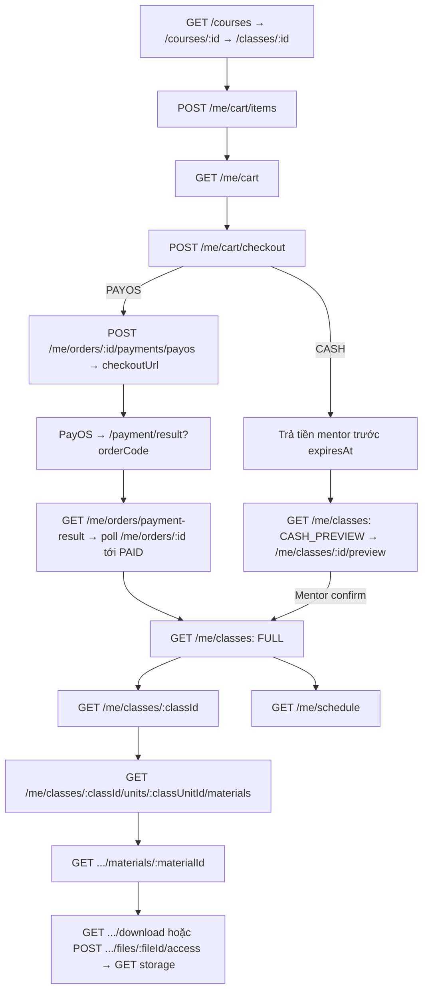

# API contract: Flow end-to-end

Thứ tự gọi API theo từng vai trò (§20), nối nhiều file domain. Đọc khi viết spec phase để biết luồng chính.

> Số mục (§) giữ nguyên theo contract gốc để tham chiếu chéo vẫn tra được. Mục nào nằm ở file nào: xem
> [bảng đối chiếu](README.md#bảng-đối-chiếu-mục-cũ-sang-file-mới). Quy ước chung (cookie, header `Origin`,
> format lỗi, `Idempotency-Key`, polling): [README.md](README.md).

---

## 20. Flow end-to-end theo vai trò

### 20.1 Student: đăng ký → thanh toán → học

### 20.2 Mentor: thu tiền + điểm danh

1. `GET /mentor/classes` → `GET /mentor/classes/:classId/students?paymentType=CASH&orderStatus=PENDING`.
2. Nhận đủ `orderTotalAmount` → `POST /mentor/cash-orders/:orderId/confirm { receivedAmount }`.
3. `GET /mentor/schedule` → chọn buổi → `GET /class-sessions/:id/context` → `GET .../attendance`.
4. `POST .../start` → tick `PUT .../attendance` → xác nhận tổng → `POST .../finalize`.
5. Nếu thu tiền CASH sau khi đã bắt đầu → `POST .../attendance/sync-roster` → refetch.

### 20.3 Mentor: soạn tài liệu

1. `GET /mentor/classes` → `GET /mentor/classes/:classId/units` (lấy `id` + `courseUnitId`) →
   (optional) `.../units/:unitId/sessions`.
2. Có file: `POST /files/upload-intents` (courseUnitId + classId + classUnitId) → PUT storage →
   `POST /files/:id/complete` → poll `GET /files/:id` tới READY.
3. `POST /mentor/classes/:classId/units/:unitId/materials` → `PATCH` khi cần → `POST .../submit`.
4. Bị reject: đọc `rejectionReason` → PATCH → submit lại.
5. Mở chương cho lớp: `PATCH /mentor/classes/:classId/units/:unitId/release`.

### 20.4 Manager: duyệt tài liệu

1. `GET /manager/materials?reviewStatus=PENDING_REVIEW` → `GET /manager/materials/:id` (lấy `revision`).
2. Preview: `POST /manager/materials/:id/files/:fileId/access` cho primary/inline/attachments.
3. `POST .../approve { expectedRevision }` hoặc `POST .../reject { expectedRevision, reason }`.
4. Tự soạn: `GET /courses/:courseId` (lấy `units[].id` = courseUnitId) → upload (không cần classId) →
   `POST /manager/course-units/:courseUnitId/materials` → approve trực tiếp.

### 20.5 Manager/Admin: dạy thay

`GET /management/classes` → `/management/classes/:id` → chọn buổi →
`GET /management/class-sessions/:id/available-mentors` → `PATCH /management/class-sessions/:id/mentor`
(Idempotency-Key) → mentor mới thấy buổi ở `/mentor/schedule`.

### 20.6 Admin: thiết lập khoá học/lớp

`POST /admin/course-categories` → `POST /admin/courses` → `POST /admin/courses/:id/units` (×n) →
`POST /admin/courses/:id/activate` → `POST /admin/users` (MENTOR) → `POST /admin/classes` →
`POST /admin/classes/:id/sessions` (×n) → `POST /admin/classes/:id/open`.
