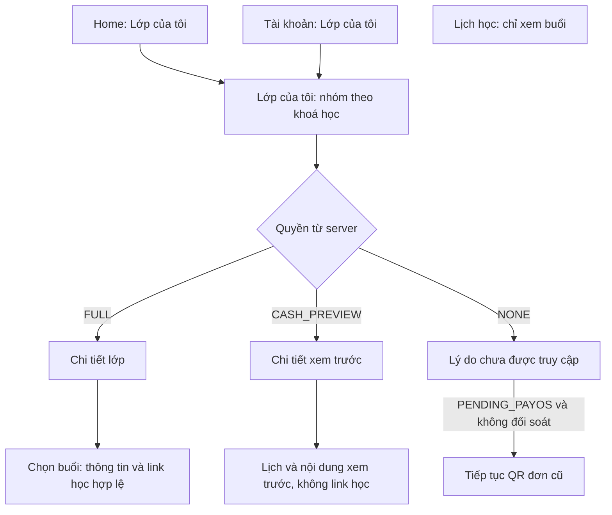

# Phase 03: Lịch học, Tài khoản, Lớp của tôi và Chi tiết lớp học

## Mục tiêu và phạm vi

Hoàn thiện hành trình Student sau khi mua khoá học: tìm lớp đã đăng ký theo khoá học, xem nội dung/lịch của lớp và mở buổi học được cấp quyền. Bổ sung tab Lịch học và Tài khoản vào app hiện có.

Owner yêu cầu gom các màn này vào Phase 3 trong chat ngày 2026-10-20; đây là phạm vi riêng của yêu cầu, tương tự Phase 1–2, không thay quy ước chung mỗi phase một màn hình. **Owner đã cho phép gắn API và duyệt ADR-0030 ngày2026-10-20. Đã nối API/route và kiểm tra Android/backend giới hạn dataset; Lịch học chỉ xem, không chuyển trang từ buổi. Owner @Bero đã duyệt UAT trong chat ngày 2026-10-21 (+07:00); Phase 3 Done. Giới hạn kiểm thử và danh sách học viên chờ API Student được giữ trong PROGRESS.** Xem [bàn giao UI](../../PROGRESS/PHASE_03_STUDENT_LEARNING/UI_REVIEW.md).

- Có: lịch tuần; Tài khoản và thông tin cá nhân chỉ đọc; Lớp của tôi nhóm theo khoá; chi tiết lớp theo FULL/CASH_PREVIEW; danh sách chương/buổi và thông tin buổi; điều hướng tới Lớp của tôi từ Home và Tài khoản; trang Khoá học giữ tab Lịch/Tài khoản.
- Đã tích hợp sau duyệt UI: API My Classes, detail/preview, schedule; tái sử dụng auth/me, logout và màn QR Phase 2 để tiếp tục đơn PAYOS còn hợp lệ.
- Chưa gồm: sửa hồ sơ/avatar/mật khẩu; đơn hàng tổng quát; thông báo/push; chứng chỉ; điểm danh Student; tiến độ học; đánh giá; compiler/phòng học nhúng; video/ghi chú; tải tài liệu; tạo giao dịch CASH; theo dõi PAID hoặc kết quả thanh toán. Các phần này trong HTML không tự trở thành phạm vi triển khai.

## Luồng course và điểm vào

Catalog → chọn lớp → giỏ → QR giữ luồng Phase 2. Không coi việc mở QR, rời QR hoặc thời gian máy trôi qua là đã mua thành công. Khi quay về app/màn lớp: refetch quyền từ server; không tự tạo enrollment hoặc chuyển FULL.

## Nguồn thiết kế

- Base: [Student Home.dc.html](../../../assets/Student%20Home%20Page%20Design/Student%20Home.dc.html), biến thể `section#t2`, state `c`; khảo sát mã nguồn ngày 2026-10-20 theo ADR-0029.
- Lịch: `c.isSchedule`, `weekDays`, `dayGroups`, ưu tiên [ảnh lịch owner](references/schedule-owner-2026-10-20.png); Account: `c.isAccount`, `showProfile`, `acctGroups`, ưu tiên [ảnh Profile owner](references/profile-owner-2026-10-20.png); My Classes: `c.subClasses`, `myCourses`; Detail: `c.roomOpen`, `detailVals`, `cd`, `sd`.
- [Bản ghi nguồn và điều chỉnh](references/DESIGN_SOURCE.md). Đã chạy Android normal và320dp/font130%; ảnh/kết quả trong [PROGRESS](../../PROGRESS/PHASE_03_STUDENT_LEARNING/README.md). Lịch dùng thêm [ảnh owner](references/schedule-owner-2026-10-20.png); [snapshot trước sửa](../../PROGRESS/PHASE_03_STUDENT_LEARNING/evidence/schedule-redesign/before.png).
- Giữ font Nunito, màu/token hiện có, tab bar 5 vị trí và phong cách row phẳng. Điều chỉnh prototype theo contract: không lấy dữ liệu tiến độ/roster/profile giả; avatar dùng chữ cái; không mở Google Meet chung.

## Mốc và phụ thuộc

| Mốc | Trạng thái | Điều kiện |
| --- | --- | --- |
| Đặc tả và triển khai UI 3.1–3.5 | Done | Owner cho phép gắn API sau chỉnh lịch chỉ xem; có ảnh/test và ADR-0030 Accepted |
| Owner xác nhận UI | Done | Owner cho phép gắn API, kèm điều chỉnh lịch chỉ xem ngày2026-10-20 |
| API 3.6 | Done | Đã triển khai/test; owner duyệt UAT ngày 2026-10-21, giới hạn giữ tại API_REVIEW |
| Owner UAT 3.99 | Done | Owner xác nhận “Tôi duyệt UAT phase 3” ngày 2026-10-21 trong chat |

Phase **Done — owner @Bero duyệt UAT ngày 2026-10-21 (+07:00)**. Xác nhận và giới hạn được ghi tại [PROGRESS](../../PROGRESS/PHASE_03_STUDENT_LEARNING/README.md). Phase 0/1/2 đã Done. Contract: [My Classes §14](../../API_CONTRACT/my-classes.md), [Auth §6](../../API_CONTRACT/auth.md), [Order/PayOS](../../API_CONTRACT/orders-payment.md), [quyền/cache/PLANNED](../../API_CONTRACT/README.md). Tuân thủ [Business Rules §4, §7](../../BUSINESS_RULES.md), guides UX/visual/testing và ADR-0021/0029.

Đăng ký route mới cần ngoại lệ file khoá: [ADR-0030 Accepted](../../adr/ADR-0030-phase-03-navigation-routes.md). Đã có quyền đăng ký route trong nhánh STUDENT; việc soạn spec và UI độc lập không bị chặn. Không thêm thư viện hoặc token mới.

## Sub-phase

| # | File | Bước | Trạng thái |
| --- | --- | --- | --- |
| 3.1 | [Lịch học](PHASE_03_01_SCHEDULE.md) | UI | Done |
| 3.2 | [Tài khoản](PHASE_03_02_ACCOUNT.md) | UI | Done |
| 3.3 | [Lớp của tôi](PHASE_03_03_MY_CLASSES.md) | UI | Done |
| 3.4 | [Chi tiết lớp học](PHASE_03_04_CLASS_DETAIL.md) | UI | Done |
| 3.5 | [Điều hướng và kiểm tra UI](PHASE_03_05_NAVIGATION.md) | UI / route | Done |
| 3.6 | [Tích hợp API](PHASE_03_06_API_INTEGRATION.md) | API | Done |
| 3.99 | [User Acceptance](PHASE_03_99_User_Acceptance.md) | UAT | Done |

Thực hiện tuần tự 3.1 → 3.5 → owner duyệt UI → 3.6 → Dọn dẹp → Kiểm tra → 3.99. UI dùng fixture/callback trong preview riêng; không cho fixture vào phiên production.

## Tiêu chí chung

- [x] Đối chiếu UI với base cộng thay đổi đã đặc tả, ở 320dp và màn thông thường; lưu ảnh và sai khác.
- [x] Loading/empty/error/success, refetch giữ dữ liệu; lỗi retry đúng vùng, có requestId khi có.
- [ ] i18n Việt/Anh; target tối thiểu 44×44dp; chữ lớn 1.3× không mất hành động; Reduce Motion và nhãn đọc màn hình.
- [x] FULL/CASH_PREVIEW/NONE và thay đổi quyền được kiểm tra; không lộ link học trong preview hoặc dữ liệu user cũ.
- [x] Lịch lấy đủ trang, đúng range/offset/timeZone; phản hồi tuần cũ không ghi đè tuần mới.
- [x] Owner duyệt UI, API thật có bằng chứng, owner UAT xác nhận riêng.
- [x] Jest/lint/format/type-check và Maestro phù hợp đạt; ghi riêng giới hạn iOS, ngân hàng và native chưa kiểm tra.

## Đồng bộ checklist (2026-10-22)

Đối chiếu bằng chứng đã ghi, không chạy lại test trong lượt đồng bộ này. Xem [bảng đối chiếu và giới hạn](../../PROGRESS/ACCEPTANCE_SYNC_2026-10-22.md) và [PROGRESS liên quan](../../PROGRESS/PHASE_03_STUDENT_LEARNING/README.md). Trạng thái Done của phase giữ theo UAT owner đã có; checkbox chỉ phản ánh phạm vi kiểm chứng, không tự thay xác nhận owner.

Kiểm tra chất lượng hiện tại có thêm CI Phase 4 run 39700197090: 63 suites/294 tests và 13 flow CI đạt; iOS là build Simulator. Đây là bằng chứng bổ sung ngày 2026-10-22, không thay số liệu/môi trường của các lượt lịch sử và không chứng minh API/thanh toán thật.

Các nhánh FULL/CASH_PREVIEW/NONE, thay đổi quyền và dữ liệu có buổi được ghi theo unit/MSW/fixture khi chưa có dataset backend phù hợp. Có native protected detail bổ sung lúc 18:44 ngày 2026-10-20; Student roster, các dataset còn thiếu và TalkBack/iOS thủ công giữ giới hạn tại API_REVIEW.

- Tiêu chí checkbox thứ 3: **Đạt một phần: có native 320dp/font130%/animator0 và nhãn accessibility; chưa đủ bằng chứng kiểm tra toàn bộ target 44x44 và TalkBack thủ công Phase 3. Không suy từ test chức năng thành kiểm tra đọc màn hình đầy đủ.**
